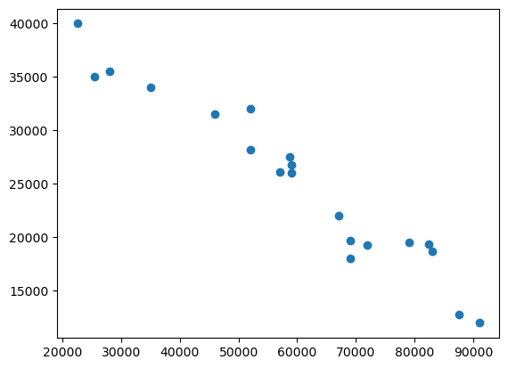
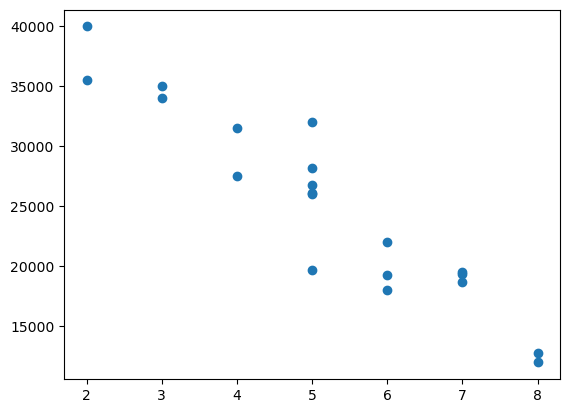
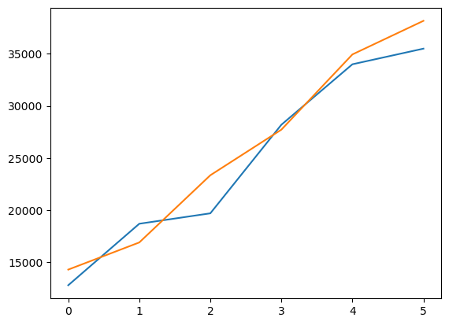

# Training And Testing

Training And Testing Available Data

Author

Benedict Thekkel

**We have a dataset containing prices of used BMW cars. We are going to analyze this dataset and build a prediction function that can predict a price by taking mileage and age of the car as input. We will use sklearn train_test_split method to split training and testing dataset**

``` python
import pandas as pd
df = pd.read_csv("Data/carprices.csv")
df.head()
```

|     | Mileage | Age(yrs) | Sell Price(\$) |
|-----|---------|----------|----------------|
| 0   | 69000   | 6        | 18000          |
| 1   | 35000   | 3        | 34000          |
| 2   | 57000   | 5        | 26100          |
| 3   | 22500   | 2        | 40000          |
| 4   | 46000   | 4        | 31500          |

``` python
import matplotlib.pyplot as plt
```

**Car Mileage Vs Sell Price (\$)**

``` python
plt.scatter(df['Mileage'],df['Sell Price($)'])
```



**Car Age Vs Sell Price (\$)**

``` python
plt.scatter(df['Age(yrs)'],df['Sell Price($)'])
```



**Looking at above two scatter plots, using linear regression model makes sense as we can clearly see a linear relationship between our dependant (i.e. Sell Price) and independant variables (i.e. car age and car mileage)**

**The approach we are going to use here is to split available data in two sets**

    <ol>
        <b>
        <li>Training: We will train our model on this dataset</li>
        <li>Testing: We will use this subset to make actual predictions using trained model</li>
        </b>
     </ol>

**The reason we don’t use same training set for testing is because our model has seen those samples before, using same samples for making predictions might give us wrong impression about accuracy of our model. It is like you ask same questions in exam paper as you tought the students in the class.**

``` python
X = df[['Mileage','Age(yrs)']]
```

``` python
y = df['Sell Price($)']
```

``` python
from sklearn.model_selection import train_test_split
X_train, X_test, y_train, y_test = train_test_split(X,y,test_size=0.3)
```

``` python
X_train
```

|     | Mileage | Age(yrs) |
|-----|---------|----------|
| 4   | 46000   | 4        |
| 13  | 58780   | 4        |
| 5   | 59000   | 5        |
| 7   | 72000   | 6        |
| 12  | 59000   | 5        |
| 11  | 79000   | 7        |
| 3   | 22500   | 2        |
| 9   | 67000   | 6        |
| 0   | 69000   | 6        |
| 8   | 91000   | 8        |
| 14  | 82450   | 7        |
| 2   | 57000   | 5        |
| 6   | 52000   | 5        |
| 15  | 25400   | 3        |

``` python
X_test
```

|     | Mileage | Age(yrs) |
|-----|---------|----------|
| 1   | 35000   | 3        |
| 10  | 83000   | 7        |
| 17  | 69000   | 5        |
| 16  | 28000   | 2        |
| 18  | 87600   | 8        |
| 19  | 52000   | 5        |

``` python
y_train
```

    4     31500
    13    27500
    5     26750
    7     19300
    12    26000
    11    19500
    3     40000
    9     22000
    0     18000
    8     12000
    14    19400
    2     26100
    6     32000
    15    35000
    Name: Sell Price($), dtype: int64

``` python
y_test
```

    1     34000
    10    18700
    17    19700
    16    35500
    18    12800
    19    28200
    Name: Sell Price($), dtype: int64

**Lets run linear regression model now**

``` python
from sklearn.linear_model import LinearRegression
clf = LinearRegression()
clf.fit(X_train, y_train)
```

    LinearRegression()

**In a Jupyter environment, please rerun this cell to show the HTML representation or trust the notebook.\
On GitHub, the HTML representation is unable to render, please try loading this page with nbviewer.org.**

LinearRegression

    LinearRegression()

``` python
X_test
```

|     | Mileage | Age(yrs) |
|-----|---------|----------|
| 1   | 35000   | 3        |
| 10  | 83000   | 7        |
| 17  | 69000   | 5        |
| 16  | 28000   | 2        |
| 18  | 87600   | 8        |
| 19  | 52000   | 5        |

``` python
clf.predict(X_test)
```

    array([34944.44210911, 16905.69832696, 23351.64782019, 38167.41685573,
           14300.34495583, 27726.46589653])

``` python
y_results = pd.DataFrame(clf.predict(X_test))
y_results
```

|     | 0            |
|-----|--------------|
| 0   | 34944.442109 |
| 1   | 16905.698327 |
| 2   | 23351.647820 |
| 3   | 38167.416856 |
| 4   | 14300.344956 |
| 5   | 27726.465897 |

``` python
y_res = y_results[0].sort_values(ascending=True).reset_index()
y_res.drop('index', axis = 1, inplace=True)
y_res
```

|     | 0            |
|-----|--------------|
| 0   | 14300.344956 |
| 1   | 16905.698327 |
| 2   | 23351.647820 |
| 3   | 27726.465897 |
| 4   | 34944.442109 |
| 5   | 38167.416856 |

``` python
y_test
```

    1     34000
    10    18700
    17    19700
    16    35500
    18    12800
    19    28200
    Name: Sell Price($), dtype: int64

``` python
y_t = y_test.sort_values(ascending=True).reset_index()
y_t
```

|     | index | Sell Price(\$) |
|-----|-------|----------------|
| 0   | 18    | 12800          |
| 1   | 10    | 18700          |
| 2   | 17    | 19700          |
| 3   | 19    | 28200          |
| 4   | 1     | 34000          |
| 5   | 16    | 35500          |

``` python
y_t.drop('index', axis = 1, inplace=True)
y_t
```

|     | Sell Price(\$) |
|-----|----------------|
| 0   | 12800          |
| 1   | 18700          |
| 2   | 19700          |
| 3   | 28200          |
| 4   | 34000          |
| 5   | 35500          |

``` python
plt.plot(y_t)
plt.plot(y_res)
```



``` python
clf.score(X_test, y_test)
```

    0.9353054216597069

**random_state argument**

``` python
X_train, X_test, y_train, y_test = train_test_split(X,y,test_size=0.3,random_state=10)
X_test
```

|     | Mileage | Age(yrs) |
|-----|---------|----------|
| 7   | 72000   | 6        |
| 10  | 83000   | 7        |
| 5   | 59000   | 5        |
| 6   | 52000   | 5        |
| 3   | 22500   | 2        |
| 18  | 87600   | 8        |

Back to top
