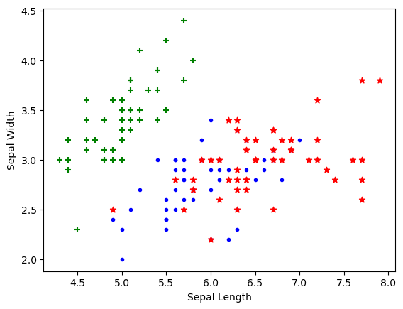
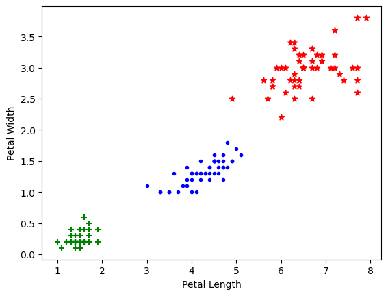
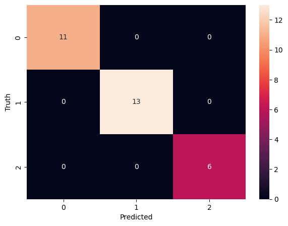
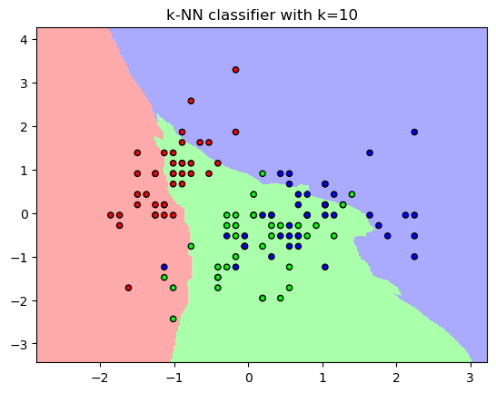
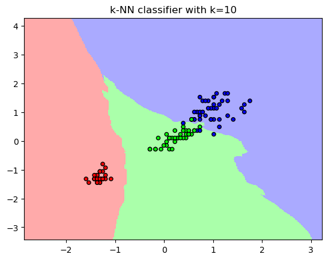

# K-NN

Take any point. It is be what its close to.

Author

Benedict Thekkel

``` python
def sayhello(name): return f'Hello {name}'
```

## Advantages

- Easy to implement: Given the algorithm’s simplicity and accuracy, it is one of the first classifiers that a new data scientist will learn.

- Adapts easily: As new training samples are added, the algorithm adjusts to account for any new data since all training data is stored into memory.

- Few hyperparameters: KNN only requires a k value and a distance metric, which is low when compared to other machine learning algorithms.

## Disadvantages

- Does not scale well: Since KNN is a lazy algorithm, it takes up more memory and data storage compared to other classifiers. This can be costly from both a time and money perspective. More memory and storage will drive up business expenses and more data can take longer to compute. While different data structures, such as Ball-Tree, have been created to address the computational inefficiencies, a different classifier may be ideal depending on the business problem.

- Curse of dimensionality: The KNN algorithm tends to fall victim to the curse of dimensionality, which means that it doesn’t perform well with high-dimensional data inputs. This is sometimes also referred to as the peaking phenomenon (PDF, 340 MB) (link resides outside of ibm.com), where after the algorithm attains the optimal number of features, additional features increases the amount of classification errors, especially when the sample size is smaller.

- Prone to overfitting: Due to the “curse of dimensionality”, KNN is also more prone to overfitting. While feature selection and dimensionality reduction techniques are leveraged to prevent this from occurring, the value of k can also impact the model’s behavior. Lower values of k can overfit the data, whereas higher values of k tend to “smooth out” the prediction values since it is averaging the values over a greater area, or neighborhood. However, if the value of k is too high, then it can underfit the data.

## Distance Metrics

- Euclidean distance (p=2): This is the most commonly used distance measure
- Manhattan distance (p=1): This is also another popular distance metric, which measures the absolute value between two points.
- Minkowski distance: This distance measure is the generalized form of Euclidean and Manhattan distance metrics.
- Hamming distance: This technique is used typically used with Boolean or string vectors, identifying the points where the vectors do not match.

## Compute KNN: defining k

The k value in the k-NN algorithm defines how many neighbors will be checked to determine the classification of a specific query point. For example, if k=1, the instance will be assigned to the same class as its single nearest neighbor. Defining k can be a balancing act as different values can lead to overfitting or underfitting. Lower values of k can have high variance, but low bias, and larger values of k may lead to high bias and lower variance. The choice of k will largely depend on the input data as data with more outliers or noise will likely perform better with higher values of k. Overall, it is recommended to have an odd number for k to avoid ties in classification, and cross-validation tactics can help you choose the optimal k for your dataset.

## Data collection

``` python
!pip list | grep pandas
!pip list | grep scikit-learn
```

    pandas                        2.0.3
    scikit-learn                  1.3.0

``` python
import pandas as pd
from sklearn.datasets import load_iris
```

``` python
iris = load_iris()
```

``` python
iris.feature_names
```

    ['sepal length (cm)',
     'sepal width (cm)',
     'petal length (cm)',
     'petal width (cm)']

``` python
iris.target_names
```

    array(['setosa', 'versicolor', 'virginica'], dtype='<U10')

``` python
iris.target
```

    array([0, 0, 0, 0, 0, 0, 0, 0, 0, 0, 0, 0, 0, 0, 0, 0, 0, 0, 0, 0, 0, 0,
           0, 0, 0, 0, 0, 0, 0, 0, 0, 0, 0, 0, 0, 0, 0, 0, 0, 0, 0, 0, 0, 0,
           0, 0, 0, 0, 0, 0, 1, 1, 1, 1, 1, 1, 1, 1, 1, 1, 1, 1, 1, 1, 1, 1,
           1, 1, 1, 1, 1, 1, 1, 1, 1, 1, 1, 1, 1, 1, 1, 1, 1, 1, 1, 1, 1, 1,
           1, 1, 1, 1, 1, 1, 1, 1, 1, 1, 1, 1, 2, 2, 2, 2, 2, 2, 2, 2, 2, 2,
           2, 2, 2, 2, 2, 2, 2, 2, 2, 2, 2, 2, 2, 2, 2, 2, 2, 2, 2, 2, 2, 2,
           2, 2, 2, 2, 2, 2, 2, 2, 2, 2, 2, 2, 2, 2, 2, 2, 2, 2])

``` python
df = pd.DataFrame(iris.data,columns=iris.feature_names)
df.head()
```

|     | sepal length (cm) | sepal width (cm) | petal length (cm) | petal width (cm) |
|-----|-------------------|------------------|-------------------|------------------|
| 0   | 5.1               | 3.5              | 1.4               | 0.2              |
| 1   | 4.9               | 3.0              | 1.4               | 0.2              |
| 2   | 4.7               | 3.2              | 1.3               | 0.2              |
| 3   | 4.6               | 3.1              | 1.5               | 0.2              |
| 4   | 5.0               | 3.6              | 1.4               | 0.2              |

``` python
df['target'] = iris.target
df.head()
```

|  | sepal length (cm) | sepal width (cm) | petal length (cm) | petal width (cm) | target |
|----|----|----|----|----|----|
| 0 | 5.1 | 3.5 | 1.4 | 0.2 | 0 |
| 1 | 4.9 | 3.0 | 1.4 | 0.2 | 0 |
| 2 | 4.7 | 3.2 | 1.3 | 0.2 | 0 |
| 3 | 4.6 | 3.1 | 1.5 | 0.2 | 0 |
| 4 | 5.0 | 3.6 | 1.4 | 0.2 | 0 |

``` python
df[df.target==1].head()
```

|  | sepal length (cm) | sepal width (cm) | petal length (cm) | petal width (cm) | target |
|----|----|----|----|----|----|
| 50 | 7.0 | 3.2 | 4.7 | 1.4 | 1 |
| 51 | 6.4 | 3.2 | 4.5 | 1.5 | 1 |
| 52 | 6.9 | 3.1 | 4.9 | 1.5 | 1 |
| 53 | 5.5 | 2.3 | 4.0 | 1.3 | 1 |
| 54 | 6.5 | 2.8 | 4.6 | 1.5 | 1 |

``` python
df[df.target==2].head()
```

|  | sepal length (cm) | sepal width (cm) | petal length (cm) | petal width (cm) | target |
|----|----|----|----|----|----|
| 100 | 6.3 | 3.3 | 6.0 | 2.5 | 2 |
| 101 | 5.8 | 2.7 | 5.1 | 1.9 | 2 |
| 102 | 7.1 | 3.0 | 5.9 | 2.1 | 2 |
| 103 | 6.3 | 2.9 | 5.6 | 1.8 | 2 |
| 104 | 6.5 | 3.0 | 5.8 | 2.2 | 2 |

``` python
df['flower_name'] =df.target.apply(lambda x: iris.target_names[x])
df.head()
```

|  | sepal length (cm) | sepal width (cm) | petal length (cm) | petal width (cm) | target | flower_name |
|----|----|----|----|----|----|----|
| 0 | 5.1 | 3.5 | 1.4 | 0.2 | 0 | setosa |
| 1 | 4.9 | 3.0 | 1.4 | 0.2 | 0 | setosa |
| 2 | 4.7 | 3.2 | 1.3 | 0.2 | 0 | setosa |
| 3 | 4.6 | 3.1 | 1.5 | 0.2 | 0 | setosa |
| 4 | 5.0 | 3.6 | 1.4 | 0.2 | 0 | setosa |

``` python
df0 = df[:50]
df1 = df[50:100]
df2 = df[100:]
```

## Data Visuals

``` python
import matplotlib.pyplot as plt
```

``` python
plt.xlabel('Sepal Length')
plt.ylabel('Sepal Width')
plt.scatter(df0['sepal length (cm)'],
            df0['sepal width (cm)'],
            color="green",marker='+')

plt.scatter(df1['sepal length (cm)'],
            df1['sepal width (cm)'],
            color="blue",marker='.')

plt.scatter(df2['sepal length (cm)'],
            df2['sepal width (cm)'],
            color="red",marker='*')
```



``` python
plt.xlabel('Petal Length')
plt.ylabel('Petal Width')
plt.scatter(df0['petal length (cm)'],
            df0['petal width (cm)'],
            color="green",marker='+')

plt.scatter(df1['petal length (cm)'],
            df1['petal width (cm)'],
            color="blue",marker='.')

plt.scatter(df2['sepal length (cm)'],
            df2['sepal width (cm)'],
            color="red",marker='*')
```



## Model Design

``` python
from sklearn.model_selection import train_test_split
```

``` python
X = df.drop(['target','flower_name'], axis='columns')
y = df.target
```

``` python
X_train, X_test, y_train, y_test = train_test_split(X,y,
                                                    test_size=0.2,
                                                    random_state=1)
```

``` python
from sklearn.preprocessing import StandardScaler
```

``` python
scaler = StandardScaler()
X_train = scaler.fit_transform(X_train)
X_test = scaler.transform(X_test)
```

``` python
len(X_train)
```

    120

``` python
len(X_test)
```

    30

## First Model: K-nn 10

``` python
from sklearn.neighbors import KNeighborsClassifier
```

``` python
n_neighbors=10
knn = KNeighborsClassifier(n_neighbors)
knn.fit(X_train, y_train)
```

    KNeighborsClassifier(n_neighbors=10)

**In a Jupyter environment, please rerun this cell to show the HTML representation or trust the notebook.\
On GitHub, the HTML representation is unable to render, please try loading this page with nbviewer.org.**

KNeighborsClassifier

    KNeighborsClassifier(n_neighbors=10)

``` python
knn.score(X_test, y_test)
```

    1.0

``` python
knn.predict([[4.8,3.0,1.5,0.3]])
```

    array([2])

``` python
from sklearn.metrics import confusion_matrix
```

``` python
y_pred = knn.predict(X_test)
cm = confusion_matrix(y_test, y_pred)
cm
```

    array([[11,  0,  0],
           [ 0, 13,  0],
           [ 0,  0,  6]])

``` python
!pip list | grep seaborn || pip install seaborn
```

    seaborn                       0.12.2

``` python
import matplotlib.pyplot as plt
import seaborn as sn
```

``` python
plt.figure(figsize=(7,5))
sn.heatmap(cm, annot=True)
plt.xlabel('Predicted')
plt.ylabel('Truth')
```



``` python
from sklearn.metrics import classification_report
```

``` python
print(classification_report(y_test, y_pred))
```

                  precision    recall  f1-score   support

               0       1.00      1.00      1.00        11
               1       1.00      1.00      1.00        13
               2       1.00      1.00      1.00         6

        accuracy                           1.00        30
       macro avg       1.00      1.00      1.00        30
    weighted avg       1.00      1.00      1.00        30

``` python
from matplotlib.colors import ListedColormap
import numpy as np
```

``` python
# Plot the decision regions
cmap_light = ListedColormap(['#FFAAAA', '#AAFFAA', '#AAAAFF'])
cmap_bold = ListedColormap(['#FF0000', '#00FF00', '#0000FF'])

# Define the resolution of the grid
h = 0.02
x_min, x_max = X_train[:, 0].min() - 1, X_train[:, 0].max() + 1
y_min, y_max = X_train[:, 1].min() - 1, X_train[:, 1].max() + 1
x1_min, x1_max = X_train[:, 2].min() - 1, X_train[:, 2].max() + 1
y1_min, y1_max = X_train[:, 3].min() - 1, X_train[:, 3].max() + 1
xx, yy = np.meshgrid(np.arange(x_min, x_max, h), np.arange(y_min, y_max, h))
xx1, yy1 = np.meshgrid(np.arange(x1_min, x1_max, h), np.arange(y1_min, y1_max, h))
```

``` python
# Predict the class labels for each point in the grid
Z = knn.predict(np.c_[xx.ravel(), yy.ravel(),xx.ravel(), yy.ravel() ])
Z = Z.reshape(xx.shape)

print(f'{len(xx)} {len(yy)} {len(xx1)} {len(yy1)} ')
```

    387 387 256 256 

``` python
# Plot the decision regions
plt.figure()
plt.pcolormesh(xx, yy, Z, cmap=cmap_light)

# Plot the training points
plt.scatter(X_train[:, 0], X_train[:, 1], c=y_train, cmap=cmap_bold,
            edgecolor='k', s=20)
plt.xlim(xx.min(), xx.max())
plt.ylim(yy.min(), yy.max())
plt.title("k-NN classifier with k={}".format(10))


plt.show()
```



``` python
len(xx1.ravel())
```

    68608

``` python
# Plot the decision regions
plt.figure()
plt.pcolormesh(xx, yy, Z, cmap=cmap_light)

# Plot the training points
plt.scatter(X_train[:, 2], X_train[:, 3], c=y_train, cmap=cmap_bold,
            edgecolor='k', s=20)
plt.xlim(xx.min(), xx.max())
plt.ylim(yy.min(), yy.max())
plt.title("k-NN classifier with k={}".format(10))
```



# KNN model with cross valication

``` python
from sklearn.model_selection import cross_val_score
import numpy as np
```

``` python
knn_cv = KNeighborsClassifier(n_neighbors=10)#train model with cv of 5 
cv_scores = cross_val_score(knn_cv, X, y, cv=5)#print each cv score (accuracy) and average them
print(cv_scores)
print('cv_scores mean:{}'.format(np.mean(cv_scores)))
```

    [0.96666667 1.         1.         0.93333333 1.        ]
    cv_scores mean:0.9800000000000001

## Knn model with GridSearchCV: finding optimum K

``` python
from sklearn.model_selection import GridSearchCV
```

- create a dictionary of all values we want to test for n_neighbors

``` python
knn2 = KNeighborsClassifier()
param_grid = {'n_neighbors': np.arange(1, 25)}
```

- use gridsearch to test all values for n_neighbors

``` python
knn_gscv = GridSearchCV(knn2, param_grid, cv=5)#fit model to data
knn_gscv.fit(X, y)
```

    GridSearchCV(cv=5, estimator=KNeighborsClassifier(),
                 param_grid={'n_neighbors': array([ 1,  2,  3,  4,  5,  6,  7,  8,  9, 10, 11, 12, 13, 14, 15, 16, 17,
           18, 19, 20, 21, 22, 23, 24])})

**In a Jupyter environment, please rerun this cell to show the HTML representation or trust the notebook.\
On GitHub, the HTML representation is unable to render, please try loading this page with nbviewer.org.**

GridSearchCV

    GridSearchCV(cv=5, estimator=KNeighborsClassifier(),
                 param_grid={'n_neighbors': array([ 1,  2,  3,  4,  5,  6,  7,  8,  9, 10, 11, 12, 13, 14, 15, 16, 17,
           18, 19, 20, 21, 22, 23, 24])})

estimator: KNeighborsClassifier

    KNeighborsClassifier()

KNeighborsClassifier

    KNeighborsClassifier()

``` python
#check top performing n_neighbors value
knn_gscv.best_params_
```

    {'n_neighbors': 6}

Back to top
