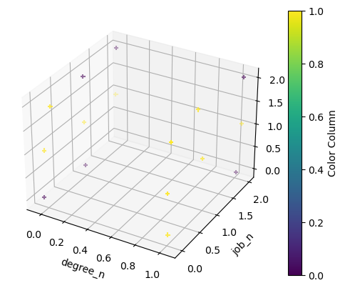
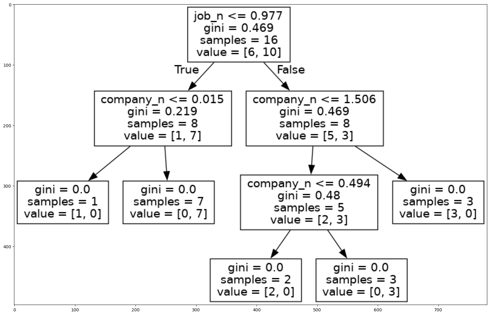

# Decision Tree

A bunch of if statement placed at low point of entropy

Author

Benedict Thekkel

## Advantages of CART

- Simple to understand, interpret, visualize.
- Decision trees implicitly performvariable screening or feature selection.
- Can handle both numerical and categorical data. Can also handle multi-output problems.
- Decision trees require relatively little effort from users for data preparation.
- Nonlinear relationships between parameters do not affect tree performance.

## Disadvantages of CART

- Decision-tree learners can create over-complex trees that do not generalize the data well. This is called overfitting.
- Decision trees can be unstable because small variations in the data might result in a completely different tree being generated. This is called variance, which needs to be lowered by methods like bagging and boosting.
- Greedy algorithms cannot guarantee to return the globally optimal decision tree. This can be mitigated by training multiple trees, where the features and samples are randomly sampled with replacement.
- Decision tree learners create biased trees if some classes dominate. It is therefore recommended to balance the data set prior to fitting with the decision tree.

``` python
import pandas as pd
from fastai.vision.all import *
```

``` python
path = Path('Data')
name = 'salaries.csv'
```

``` python
df = pd.read_csv(path/name)
df.head()
```

|     | company | job                 | degree    | salary_more_then_100k |
|-----|---------|---------------------|-----------|-----------------------|
| 0   | google  | sales executive     | bachelors | 0                     |
| 1   | google  | sales executive     | masters   | 0                     |
| 2   | google  | business manager    | bachelors | 1                     |
| 3   | google  | business manager    | masters   | 1                     |
| 4   | google  | computer programmer | bachelors | 0                     |

``` python
inputs = df.drop('salary_more_then_100k',axis='columns')
```

``` python
target = df['salary_more_then_100k']
```

``` python
from sklearn.preprocessing import LabelEncoder
```

``` python
le_company = LabelEncoder()
le_job = LabelEncoder()
le_degree = LabelEncoder()
```

``` python
inputs['company_n'] = le_company.fit_transform(inputs['company'])
inputs['job_n'] = le_job.fit_transform(inputs['job'])
inputs['degree_n'] = le_degree.fit_transform(inputs['degree'])
```

``` python
inputs
```

|     | company    | job                 | degree    | company_n | job_n | degree_n |
|-----|------------|---------------------|-----------|-----------|-------|----------|
| 0   | google     | sales executive     | bachelors | 2         | 2     | 0        |
| 1   | google     | sales executive     | masters   | 2         | 2     | 1        |
| 2   | google     | business manager    | bachelors | 2         | 0     | 0        |
| 3   | google     | business manager    | masters   | 2         | 0     | 1        |
| 4   | google     | computer programmer | bachelors | 2         | 1     | 0        |
| 5   | google     | computer programmer | masters   | 2         | 1     | 1        |
| 6   | abc pharma | sales executive     | masters   | 0         | 2     | 1        |
| 7   | abc pharma | computer programmer | bachelors | 0         | 1     | 0        |
| 8   | abc pharma | business manager    | bachelors | 0         | 0     | 0        |
| 9   | abc pharma | business manager    | masters   | 0         | 0     | 1        |
| 10  | facebook   | sales executive     | bachelors | 1         | 2     | 0        |
| 11  | facebook   | sales executive     | masters   | 1         | 2     | 1        |
| 12  | facebook   | business manager    | bachelors | 1         | 0     | 0        |
| 13  | facebook   | business manager    | masters   | 1         | 0     | 1        |
| 14  | facebook   | computer programmer | bachelors | 1         | 1     | 0        |
| 15  | facebook   | computer programmer | masters   | 1         | 1     | 1        |

``` python
inputs_n = inputs.drop(['company','job','degree'],axis='columns')
```

``` python
inputs_n
```

|     | company_n | job_n | degree_n |
|-----|-----------|-------|----------|
| 0   | 2         | 2     | 0        |
| 1   | 2         | 2     | 1        |
| 2   | 2         | 0     | 0        |
| 3   | 2         | 0     | 1        |
| 4   | 2         | 1     | 0        |
| 5   | 2         | 1     | 1        |
| 6   | 0         | 2     | 1        |
| 7   | 0         | 1     | 0        |
| 8   | 0         | 0     | 0        |
| 9   | 0         | 0     | 1        |
| 10  | 1         | 2     | 0        |
| 11  | 1         | 2     | 1        |
| 12  | 1         | 0     | 0        |
| 13  | 1         | 0     | 1        |
| 14  | 1         | 1     | 0        |
| 15  | 1         | 1     | 1        |

``` python
import matplotlib.pyplot as plt
import numpy as np
```

``` python
np.random.seed(42)
n_points = len(inputs_n)
x = np.random.rand(n_points)
y = np.random.rand(n_points)
z = np.random.rand(n_points)
```

``` python
inputs_n['company_n'] += (x-0.5)/10
inputs_n['job_n'] += (y-0.5)/10
inputs_n['degree_n'] += (z-0.5)/10
```

``` python
# Create a 3D scatter plot
fig = plt.figure()
ax = fig.add_subplot(111, projection='3d')

ax.set_xlabel('degree_n')
ax.set_ylabel('job_n')
ax.set_zlabel('company_n')

scatter = ax.scatter(inputs_n['degree_n'],
           inputs_n['job_n'],
           inputs_n['company_n'],
           c=target,
           cmap='viridis',
           marker='+')

# Adding a color bar to show the mapping of colors to values in 'color_column'
cbar = fig.colorbar(scatter, ax=ax)
cbar.set_label('Color Column')
```



``` python
target
```

    0     0
    1     0
    2     1
    3     1
    4     0
    5     1
    6     0
    7     0
    8     0
    9     1
    10    1
    11    1
    12    1
    13    1
    14    1
    15    1
    Name: salary_more_then_100k, dtype: int64

``` python
from sklearn import tree
```

``` python
model = tree.DecisionTreeClassifier()
model.fit(inputs_n, target)
```

    DecisionTreeClassifier()

**In a Jupyter environment, please rerun this cell to show the HTML representation or trust the notebook.\
On GitHub, the HTML representation is unable to render, please try loading this page with nbviewer.org.**

DecisionTreeClassifier

    DecisionTreeClassifier()

``` python
model.score(inputs_n,target)
```

    1.0

``` python
from sklearn.tree import export_graphviz
```

``` python
FEATURE_NAMES = ['company_n', 'job_n', 'degree_n']
export_graphviz(model, './Data/salary.dot', feature_names = FEATURE_NAMES)
```

``` python
!dot -Tpng ./Data/salary.dot -o ./Data/salary.png
```

``` python
import matplotlib.pyplot as plt
import cv2 as cv
```

``` python
img = cv.imread('./Data/salary.png')
plt.figure(figsize = (20, 20))
plt.imshow(img)
```



## Predict

``` python
model.predict([[2,1,0]])
```

    /home/ben/mambaforge/envs/cfast/lib/python3.11/site-packages/sklearn/base.py:464: UserWarning: X does not have valid feature names, but DecisionTreeClassifier was fitted with feature names
      warnings.warn(

    array([0])

``` python
model.predict([[2,1,1]])
```

    /home/ben/mambaforge/envs/cfast/lib/python3.11/site-packages/sklearn/base.py:464: UserWarning: X does not have valid feature names, but DecisionTreeClassifier was fitted with feature names
      warnings.warn(

    array([0])

Back to top
