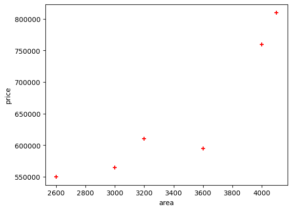
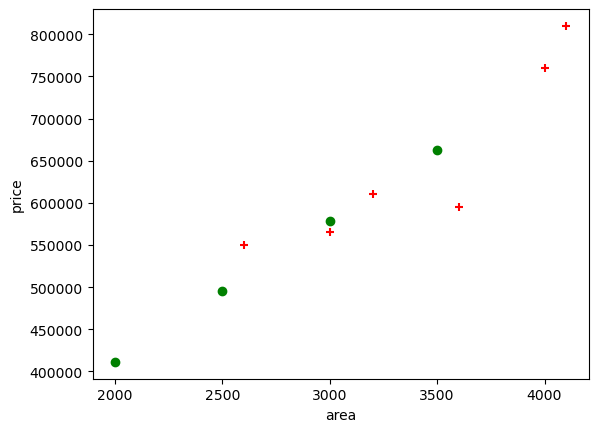

# Linear Regression

Predicted value is continuous

Author

Benedict Thekkel

``` python
import pandas as pd
import numpy as np
import matplotlib.pyplot as plt
from pathlib import Path
```

``` python
path = Path('Data/homeprices.csv')
df = pd.read_csv(path)
df
```

|     | area | bedrooms | age | price  |
|-----|------|----------|-----|--------|
| 0   | 2600 | 3.0      | 20  | 550000 |
| 1   | 3000 | 4.0      | 15  | 565000 |
| 2   | 3200 | NaN      | 18  | 610000 |
| 3   | 3600 | 3.0      | 30  | 595000 |
| 4   | 4000 | 5.0      | 8   | 760000 |
| 5   | 4100 | 6.0      | 8   | 810000 |

``` python
plt.xlabel('area')
plt.ylabel('price')
plt.scatter(df.area,df.price,color='red',marker='+')

plt.show()
```



``` python
new_df = df.drop('price',axis='columns')
new_df = new_df.drop('bedrooms',axis='columns')
new_df = new_df.drop('age',axis='columns')
new_df
```

|     | area |
|-----|------|
| 0   | 2600 |
| 1   | 3000 |
| 2   | 3200 |
| 3   | 3600 |
| 4   | 4000 |
| 5   | 4100 |

``` python
price = df.price
price
```

    0    550000
    1    565000
    2    610000
    3    595000
    4    760000
    5    810000
    Name: price, dtype: int64

``` python
from sklearn import linear_model
```

``` python
# Create linear regression object
reg = linear_model.LinearRegression()
reg.fit(new_df,price)
```

    LinearRegression()

**In a Jupyter environment, please rerun this cell to show the HTML representation or trust the notebook.\
On GitHub, the HTML representation is unable to render, please try loading this page with nbviewer.org.**

LinearRegression

    LinearRegression()

``` python
reg.predict([[3300]])
```

    /home/ben/mambaforge/envs/cfast/lib/python3.11/site-packages/sklearn/base.py:464: UserWarning: X does not have valid feature names, but LinearRegression was fitted with feature names
      warnings.warn(

    array([628813.88621022])

``` python
reg.coef_
```

    array([167.30954677])

``` python
reg.intercept_
```

    76692.3818707813

Y = m \* X + b (m is coefficient and b is intercept)

``` python
5000*reg.coef_ + reg.intercept_
```

    array([913240.11571842])

``` python
reg.predict([[5000]])
```

    /home/ben/mambaforge/envs/cfast/lib/python3.11/site-packages/sklearn/base.py:464: UserWarning: X does not have valid feature names, but LinearRegression was fitted with feature names
      warnings.warn(

    array([913240.11571842])

## Generate CSV file with list of home price predictions

# Create a list of numbers from 1000 to 5000 with 500 increments

``` python
numbers_list = list(range(2000, 4000, 500))
```

``` python
# Create a DataFrame using the pandas constructor and a dictionary
data = {'area': numbers_list}
area_df = pd.DataFrame(data)
area_df
```

|     | area |
|-----|------|
| 0   | 2000 |
| 1   | 2500 |
| 2   | 3000 |
| 3   | 3500 |

``` python
p = reg.predict(area_df)
p
```

    array([411311.47540984, 494966.2487946 , 578621.02217936, 662275.79556413])

``` python
area_df['prices']=p
area_df
```

|     | area | prices        |
|-----|------|---------------|
| 0   | 2000 | 411311.475410 |
| 1   | 2500 | 494966.248795 |
| 2   | 3000 | 578621.022179 |
| 3   | 3500 | 662275.795564 |

``` python
plt.xlabel('area')
plt.ylabel('price')
plt.scatter(df.area,
            df.price,
            color='red',
            marker='+')

plt.scatter(area_df.area,
            area_df.prices,
            color='green',
            marker='o')

plt.show()
```



``` python
area_df.to_csv("./Data/prediction.csv")
```

Back to top
