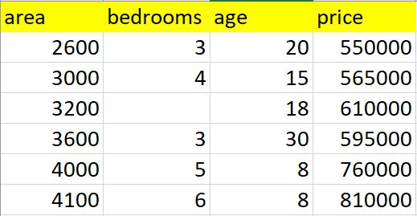
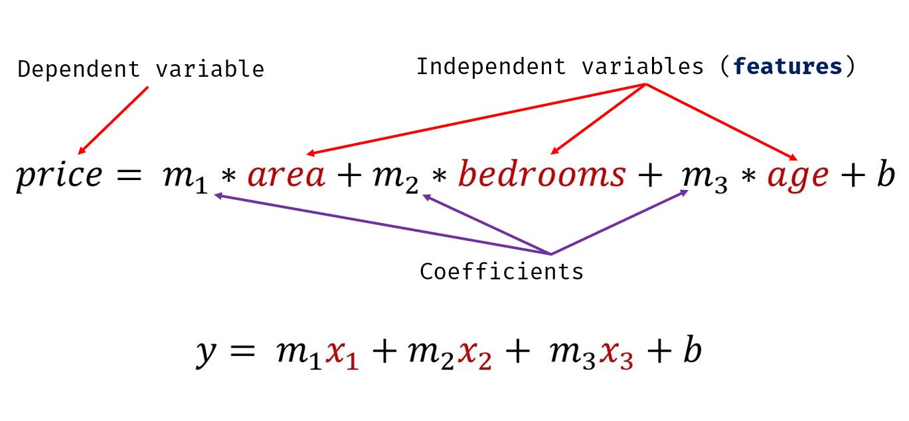
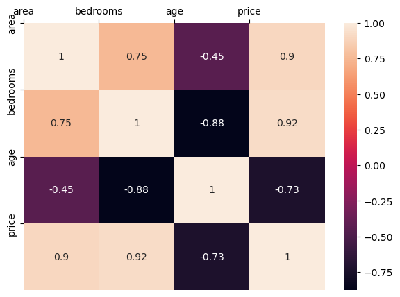

# Multi-Linear Regression

Multiple Variables Linear Regression

Author

Benedict Thekkel

## Sample problem of predicting home price in monroe, new jersey (USA)

Below is the table containing home prices in monroe twp, NJ. Here price depends on **area (square feet), bed rooms and age of the home (in years)**. Given these prices we have to predict prices of new homes based on area, bed rooms and age.



Given these home prices find out price of a home that has,

**3000 sqr ft area, 3 bedrooms, 40 year old**

**2500 sqr ft area, 4 bedrooms, 5 year old**

We will use regression with multiple variables here. Price can be calculated using following equation,



Here area, bedrooms, age are called independant variables or **features** whereas price is a dependant variable

``` python
import pandas as pd
import numpy as np
from sklearn import linear_model
```

``` python
df = pd.read_csv('./Data/homeprices.csv')
df
```

|     | area | bedrooms | age | price  |
|-----|------|----------|-----|--------|
| 0   | 2600 | 3.0      | 20  | 550000 |
| 1   | 3000 | 4.0      | 15  | 565000 |
| 2   | 3200 | NaN      | 18  | 610000 |
| 3   | 3600 | 3.0      | 30  | 595000 |
| 4   | 4000 | 5.0      | 8   | 760000 |
| 5   | 4100 | 6.0      | 8   | 810000 |

**Data Preprocessing: Fill NA values with median value of a column**

``` python
df.bedrooms.median()
```

    4.0

``` python
df.bedrooms = df.bedrooms.fillna(df.bedrooms.median())
df
```

|     | area | bedrooms | age | price  |
|-----|------|----------|-----|--------|
| 0   | 2600 | 3.0      | 20  | 550000 |
| 1   | 3000 | 4.0      | 15  | 565000 |
| 2   | 3200 | 4.0      | 18  | 610000 |
| 3   | 3600 | 3.0      | 30  | 595000 |
| 4   | 4000 | 5.0      | 8   | 760000 |
| 5   | 4100 | 6.0      | 8   | 810000 |

``` python
reg = linear_model.LinearRegression()
reg.fit(df.drop('price',axis='columns'),df.price)
```

    LinearRegression()

**In a Jupyter environment, please rerun this cell to show the HTML representation or trust the notebook.\
On GitHub, the HTML representation is unable to render, please try loading this page with nbviewer.org.**

LinearRegression

    LinearRegression()

``` python
reg.coef_
```

    array([  112.06244194, 23388.88007794, -3231.71790863])

``` python
reg.intercept_
```

    221323.00186540408

**Find price of home with 3000 sqr ft area, 3 bedrooms, 40 year old**

``` python
reg.predict([[3000, 3, 40]])
```

    /home/ben/mambaforge/envs/cfast/lib/python3.11/site-packages/sklearn/base.py:464: UserWarning: X does not have valid feature names, but LinearRegression was fitted with feature names
      warnings.warn(

    array([498408.25158031])

``` python
112.06244194*3000 + 23388.88007794*3 + -3231.71790863*40 + 221323.00186540384
```

    498408.25157402386

**Find price of home with 2500 sqr ft area, 4 bedrooms, 5 year old**

``` python
reg.predict([[2500, 4, 5]])
```

    /home/ben/mambaforge/envs/cfast/lib/python3.11/site-packages/sklearn/base.py:464: UserWarning: X does not have valid feature names, but LinearRegression was fitted with feature names
      warnings.warn(

    array([578876.03748933])

``` python
np.set_printoptions(precision=2, suppress=True)
corrcoef = np.corrcoef(df, rowvar=False)
corrcoef
```

    array([[ 1.  ,  0.75, -0.45,  0.9 ],
           [ 0.75,  1.  , -0.88,  0.92],
           [-0.45, -0.88,  1.  , -0.73],
           [ 0.9 ,  0.92, -0.73,  1.  ]])

``` python
import matplotlib.pyplot as plt
import seaborn as sn
```

``` python
df.columns
```

    Index(['area', 'bedrooms', 'age', 'price'], dtype='object')

``` python
plt.figure(figsize=(7,5))
sn.heatmap(corrcoef, annot=True)

plt.xticks(range(len(df.columns)), df.columns)
plt.yticks(range(len(df.columns)), df.columns)
# Move x-axis ticks and labels to the top
plt.gca().xaxis.set_ticks_position('top')


plt.show()
```



### Exercise

### 

In exercise folder (same level as this notebook on github) there is **hiring.csv**. This file contains hiring statics for a firm such as experience of candidate, his written test score and personal interview score. Based on these 3 factors, HR will decide the salary. Given this data, you need to build a machine learning model for HR department that can help them decide salaries for future candidates. Using this predict salaries for following candidates,

**2 yr experience, 9 test score, 6 interview score**

**12 yr experience, 10 test score, 10 interview score**

### Answer

### 

53713.86 and 93747.79

Back to top
