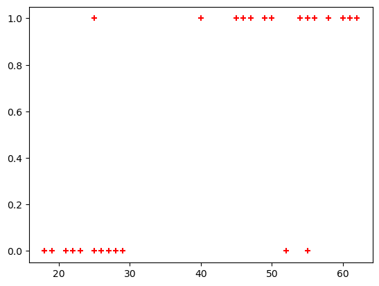
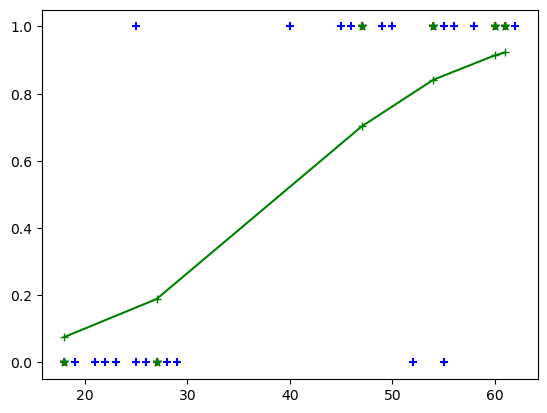
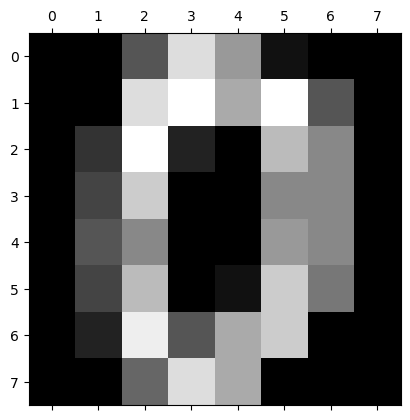
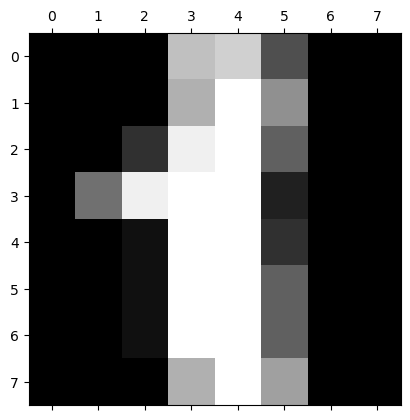
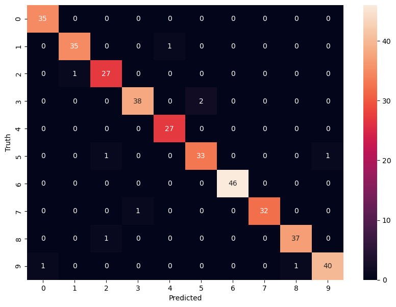

# Logistic Regression

Predicted value is categorical

Author

Benedict Thekkel

## Classification types

- Binary Classification
- Multiclass Classification

## Binary Classification

``` python
import pandas as pd
from matplotlib import pyplot as plt
from pathlib import Path
import numpy as np
```

``` python
path = Path('Data/insurance_data.csv')
df = pd.read_csv(path)
df.head()
```

|     | age | bought_insurance |
|-----|-----|------------------|
| 0   | 22  | 0                |
| 1   | 25  | 0                |
| 2   | 47  | 1                |
| 3   | 52  | 0                |
| 4   | 46  | 1                |

$\text{sigmoid}(z) = \dfrac{1}{1+e^-z}$ where e = Euler’s number ~ 2.71828

``` python
plt.scatter(df.age,df.bought_insurance,marker='+',color='red')
```



``` python
from sklearn.model_selection import train_test_split
from sklearn.linear_model import LogisticRegression
```

``` python
X_train, X_test, y_train, y_test = train_test_split(df[['age']],df.bought_insurance,train_size=0.8)
```

``` python
X_test
```

|     | age |
|-----|-----|
| 12  | 27  |
| 25  | 54  |
| 7   | 60  |
| 2   | 47  |
| 10  | 18  |
| 9   | 61  |

``` python
model = LogisticRegression()
```

``` python
model.fit(X_train, y_train)
```

    LogisticRegression()

**In a Jupyter environment, please rerun this cell to show the HTML representation or trust the notebook.\
On GitHub, the HTML representation is unable to render, please try loading this page with nbviewer.org.**

LogisticRegression

    LogisticRegression()

``` python
X_test
```

|     | age |
|-----|-----|
| 12  | 27  |
| 25  | 54  |
| 7   | 60  |
| 2   | 47  |
| 10  | 18  |
| 9   | 61  |

``` python
y_predicted = model.predict(X_test)
y_predicted
```

    array([0, 1, 1, 1, 0, 1])

``` python
y_probability = model.predict_proba(X_test)
```

``` python
model.score(X_test,y_test)
```

    1.0

``` python
array1 = np.array(X_test)

# Stack the arrays horizontally
combined_array = np.hstack((array1, y_probability[:,1].reshape(-1, 1)))

print("Combined Array:")
print(combined_array)
```

    Combined Array:
    [[27.          0.18888707]
     [54.          0.84143616]
     [60.          0.91401439]
     [47.          0.70233749]
     [18.          0.07590529]
     [61.          0.92268871]]

``` python
sorted_array = np.sort(combined_array, 0)
sorted_array[:,0]
```

    array([18., 27., 47., 54., 60., 61.])

``` python
plt.scatter(df.age,df.bought_insurance,marker='+',color='blue')
plt.scatter(X_test,y_test,marker='+',color='red')
plt.plot(sorted_array[:,0],sorted_array[:,1],marker='+',color='green')
plt.scatter(X_test,y_predicted,marker='*',color='green')
```



## Multiclass Regression

``` python
from sklearn.datasets import load_digits
import matplotlib.pyplot as plt
```

``` python
digits = load_digits()
```

``` python
plt.gray() 
for i in range(2):
    plt.matshow(digits.images[i])
```

    <Figure size 640x480 with 0 Axes>





``` python
dir(digits)
```

    ['DESCR', 'data', 'feature_names', 'frame', 'images', 'target', 'target_names']

``` python
digits.target[:]
```

    array([0, 1, 2, ..., 8, 9, 8])

``` python
from sklearn.linear_model import LogisticRegression
from sklearn.model_selection import train_test_split
```

``` python
model = LogisticRegression()
```

``` python
X_train, X_test, y_train, y_test = train_test_split(digits.data,digits.target, test_size=0.2)
```

``` python
model.fit(X_train, y_train)
```

    /home/ben/mambaforge/envs/cfast/lib/python3.11/site-packages/sklearn/linear_model/_logistic.py:460: ConvergenceWarning: lbfgs failed to converge (status=1):
    STOP: TOTAL NO. of ITERATIONS REACHED LIMIT.

    Increase the number of iterations (max_iter) or scale the data as shown in:
        https://scikit-learn.org/stable/modules/preprocessing.html
    Please also refer to the documentation for alternative solver options:
        https://scikit-learn.org/stable/modules/linear_model.html#logistic-regression
      n_iter_i = _check_optimize_result(

    LogisticRegression()

**In a Jupyter environment, please rerun this cell to show the HTML representation or trust the notebook.\
On GitHub, the HTML representation is unable to render, please try loading this page with nbviewer.org.**

LogisticRegression

    LogisticRegression()

``` python
model.score(X_test, y_test)
```

    0.9722222222222222

``` python
model.predict(digits.data[0:5])
```

    array([0, 1, 2, 3, 4])

``` python
y_predicted = model.predict(X_test)
```

    array([5, 4, 0, 2, 9, 5, 3, 2, 0, 4, 1, 3, 5, 1, 5, 3, 6, 3, 5, 2, 3, 2,
           0, 8, 1, 9, 6, 7, 0, 8, 9, 4, 5, 7, 2, 4, 4, 4, 8, 3, 7, 8, 3, 6,
           4, 9, 2, 4, 6, 3, 5, 1, 6, 0, 7, 9, 4, 8, 8, 3, 8, 9, 5, 6, 4, 9,
           8, 5, 2, 0, 7, 7, 6, 2, 5, 8, 9, 5, 7, 5, 5, 4, 4, 8, 9, 8, 9, 2,
           1, 0, 7, 4, 8, 6, 3, 3, 3, 8, 1, 1, 5, 6, 7, 6, 1, 7, 2, 8, 1, 5,
           3, 4, 4, 9, 5, 0, 7, 0, 6, 3, 2, 2, 4, 3, 4, 8, 6, 0, 8, 0, 3, 1,
           4, 9, 0, 3, 2, 9, 9, 6, 7, 8, 4, 6, 8, 6, 9, 0, 4, 9, 7, 6, 8, 3,
           9, 6, 0, 7, 1, 7, 2, 5, 2, 3, 3, 8, 0, 0, 9, 4, 4, 5, 9, 0, 8, 8,
           7, 9, 9, 8, 3, 3, 8, 7, 0, 4, 6, 6, 1, 1, 9, 0, 3, 1, 3, 9, 2, 8,
           3, 7, 4, 5, 5, 7, 2, 1, 9, 5, 5, 7, 9, 1, 9, 1, 7, 6, 5, 1, 6, 7,
           5, 6, 7, 2, 9, 4, 9, 0, 8, 3, 3, 6, 0, 1, 3, 3, 9, 6, 1, 5, 1, 6,
           6, 3, 1, 0, 1, 0, 2, 2, 1, 9, 7, 9, 1, 0, 9, 1, 3, 8, 1, 5, 0, 0,
           8, 6, 1, 2, 6, 6, 9, 5, 3, 6, 3, 8, 9, 8, 6, 9, 7, 2, 8, 5, 9, 6,
           9, 7, 3, 7, 4, 3, 2, 1, 5, 8, 0, 8, 6, 6, 7, 5, 6, 6, 4, 6, 3, 7,
           2, 3, 6, 8, 5, 3, 1, 6, 8, 8, 9, 0, 8, 5, 6, 8, 0, 1, 2, 0, 0, 1,
           9, 6, 7, 6, 3, 2, 0, 5, 5, 2, 7, 1, 6, 4, 6, 0, 2, 5, 2, 0, 7, 6,
           9, 6, 1, 9, 1, 1, 0, 0])

``` python
from sklearn.metrics import confusion_matrix
import seaborn as sn
```

``` python
cm = confusion_matrix(y_test, y_predicted)
plt.figure(figsize = (10,7))
sn.heatmap(cm, annot=True)
plt.xlabel('Predicted')
plt.ylabel('Truth')
```



``` python
from sklearn.metrics import classification_report
```

``` python
report = classification_report(y_test, y_predicted)
print(report)
```

                  precision    recall  f1-score   support

               0       0.97      1.00      0.99        35
               1       0.97      0.97      0.97        36
               2       0.93      0.96      0.95        28
               3       0.97      0.95      0.96        40
               4       0.96      1.00      0.98        27
               5       0.94      0.94      0.94        35
               6       1.00      1.00      1.00        46
               7       1.00      0.97      0.98        33
               8       0.97      0.97      0.97        38
               9       0.98      0.95      0.96        42

        accuracy                           0.97       360
       macro avg       0.97      0.97      0.97       360
    weighted avg       0.97      0.97      0.97       360

Back to top
