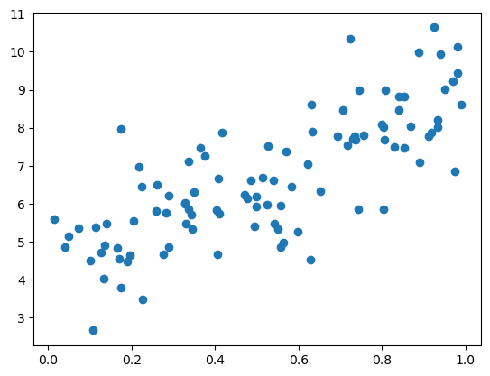
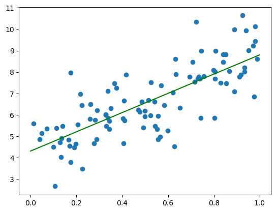
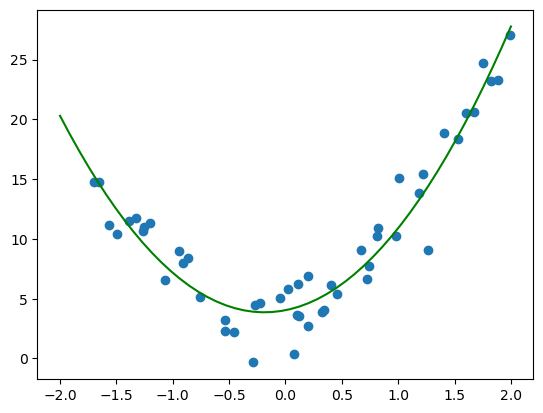
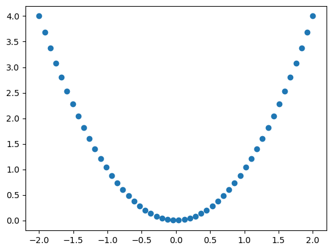
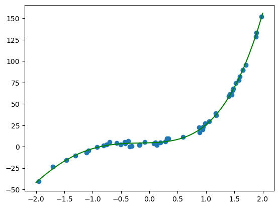

# Polynomial Regression

Polynomial Regression

Author

Benedict Thekkel

``` python
import numpy as np
import matplotlib.pyplot as plt
from sklearn.linear_model import LinearRegression
from sklearn.preprocessing import PolynomialFeatures
```

``` python
X = np.random.rand(100,1)
y = 4 + 5 * X + 1 * np.random.randn(100, 1)
```

``` python
plt.scatter(X, y)
plt.show()
```



``` python
reg = LinearRegression()
reg.fit(X, y)
```

    LinearRegression()

**In a Jupyter environment, please rerun this cell to show the HTML representation or trust the notebook.\
On GitHub, the HTML representation is unable to render, please try loading this page with nbviewer.org.**

LinearRegression

    LinearRegression()

``` python
X_vals = np.linspace(0, 1, 100).reshape(-1,1)
y_vals = reg.predict(X_vals)
plt.scatter(X, y)
plt.plot(X_vals, y_vals, color ='g')
plt.show()
```



## Second Order

``` python
X = 4 * np.random.rand(50,1) -2
y = 4 + 2 * X + 5 * X ** 2 + 2 * np.random.randn(50, 1)
```

``` python
poly_features = PolynomialFeatures(degree = 2, include_bias = False)
X_poly = poly_features.fit_transform(X)
```

``` python
reg1 = LinearRegression()
reg1.fit(X_poly, y)
```

    LinearRegression()

**In a Jupyter environment, please rerun this cell to show the HTML representation or trust the notebook.\
On GitHub, the HTML representation is unable to render, please try loading this page with nbviewer.org.**

LinearRegression

    LinearRegression()

``` python
X_vals = np.linspace(-2, 2, 50).reshape(-1,1)
X_vals_poly = poly_features.transform(X_vals)
y_vals = reg1.predict(X_vals_poly)
plt.scatter(X, y)
plt.plot(X_vals, y_vals, color ='g')
plt.show()
```



``` python
X_vals_poly[:,1]
```

    array([4.00000000e+00, 3.68013328e+00, 3.37359434e+00, 3.08038317e+00,
           2.80049979e+00, 2.53394419e+00, 2.28071637e+00, 2.04081633e+00,
           1.81424406e+00, 1.60099958e+00, 1.40108288e+00, 1.21449396e+00,
           1.04123282e+00, 8.81299459e-01, 7.34693878e-01, 6.01416077e-01,
           4.81466056e-01, 3.74843815e-01, 2.81549354e-01, 2.01582674e-01,
           1.34943773e-01, 8.16326531e-02, 4.16493128e-02, 1.49937526e-02,
           1.66597251e-03, 1.66597251e-03, 1.49937526e-02, 4.16493128e-02,
           8.16326531e-02, 1.34943773e-01, 2.01582674e-01, 2.81549354e-01,
           3.74843815e-01, 4.81466056e-01, 6.01416077e-01, 7.34693878e-01,
           8.81299459e-01, 1.04123282e+00, 1.21449396e+00, 1.40108288e+00,
           1.60099958e+00, 1.81424406e+00, 2.04081633e+00, 2.28071637e+00,
           2.53394419e+00, 2.80049979e+00, 3.08038317e+00, 3.37359434e+00,
           3.68013328e+00, 4.00000000e+00])

``` python
plt.scatter(X_vals, X_vals_poly[:,1])
```



## Higher Order

``` python
X = 4 * np.random.rand(50,1) -2
y = 4 + 2 * X + 5 * X ** 2 + 12 * X ** 3 + 2 * X ** 4 + + 2 * np.random.randn(50, 1)

poly_features = PolynomialFeatures(degree = 4, include_bias = False)
X_poly = poly_features.fit_transform(X)

reg2 = LinearRegression()
reg2.fit(X_poly, y)

X_vals = np.linspace(-2, 2, 50).reshape(-1,1)
X_vals_poly = poly_features.transform(X_vals)
y_vals = reg2.predict(X_vals_poly)
plt.scatter(X, y)
plt.plot(X_vals, y_vals, color ='g')
plt.show()
```



Back to top
