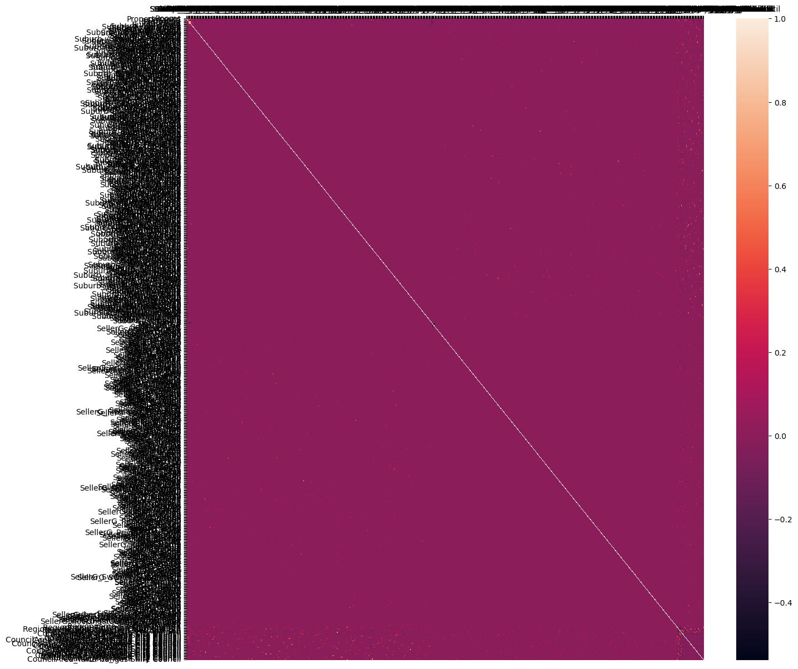

# L1 and L2 Regularization

L1 and L2 Regularization

Author

Benedict Thekkel

``` python
# import libraries
import numpy as np
import matplotlib.pyplot as plt
import pandas as pd
import seaborn as sns
```

``` python
# Suppress Warnings for clean notebook
import warnings
warnings.filterwarnings('ignore')
```

**We are going to use Melbourne House Price Dataset where we’ll predict House Predictions based on various features.** \#### The Dataset Link is https://www.kaggle.com/anthonypino/melbourne-housing-market

``` python
# read dataset
dataset_og = pd.read_csv('./Data/Melbourne_housing_FULL.csv')
```

``` python
dataset_og.head()
```

|  | Suburb | Address | Rooms | Type | Price | Method | SellerG | Date | Distance | Postcode | ... | Bathroom | Car | Landsize | BuildingArea | YearBuilt | CouncilArea | Lattitude | Longtitude | Regionname | Propertycount |
|----|----|----|----|----|----|----|----|----|----|----|----|----|----|----|----|----|----|----|----|----|----|
| 0 | Abbotsford | 68 Studley St | 2 | h | NaN | SS | Jellis | 3/09/2016 | 2.5 | 3067.0 | ... | 1.0 | 1.0 | 126.0 | NaN | NaN | Yarra City Council | -37.8014 | 144.9958 | Northern Metropolitan | 4019.0 |
| 1 | Abbotsford | 85 Turner St | 2 | h | 1480000.0 | S | Biggin | 3/12/2016 | 2.5 | 3067.0 | ... | 1.0 | 1.0 | 202.0 | NaN | NaN | Yarra City Council | -37.7996 | 144.9984 | Northern Metropolitan | 4019.0 |
| 2 | Abbotsford | 25 Bloomburg St | 2 | h | 1035000.0 | S | Biggin | 4/02/2016 | 2.5 | 3067.0 | ... | 1.0 | 0.0 | 156.0 | 79.0 | 1900.0 | Yarra City Council | -37.8079 | 144.9934 | Northern Metropolitan | 4019.0 |
| 3 | Abbotsford | 18/659 Victoria St | 3 | u | NaN | VB | Rounds | 4/02/2016 | 2.5 | 3067.0 | ... | 2.0 | 1.0 | 0.0 | NaN | NaN | Yarra City Council | -37.8114 | 145.0116 | Northern Metropolitan | 4019.0 |
| 4 | Abbotsford | 5 Charles St | 3 | h | 1465000.0 | SP | Biggin | 4/03/2017 | 2.5 | 3067.0 | ... | 2.0 | 0.0 | 134.0 | 150.0 | 1900.0 | Yarra City Council | -37.8093 | 144.9944 | Northern Metropolitan | 4019.0 |

5 rows × 21 columns

``` python
dataset_og.nunique()
```

    Suburb             351
    Address          34009
    Rooms               12
    Type                 3
    Price             2871
    Method               9
    SellerG            388
    Date                78
    Distance           215
    Postcode           211
    Bedroom2            15
    Bathroom            11
    Car                 15
    Landsize          1684
    BuildingArea       740
    YearBuilt          160
    CouncilArea         33
    Lattitude        13402
    Longtitude       14524
    Regionname           8
    Propertycount      342
    dtype: int64

``` python
# let's use limited columns which makes more sense for serving our purpose
cols_to_use = ['Suburb', 'Rooms', 'Type', 'Method', 'SellerG', 'Regionname', 'Propertycount', 
               'Distance', 'CouncilArea', 'Bedroom2', 'Bathroom', 'Car', 'Landsize', 'BuildingArea', 'Price']
dataset = dataset_og[cols_to_use]
```

``` python
dataset.head()
```

|  | Suburb | Rooms | Type | Method | SellerG | Regionname | Propertycount | Distance | CouncilArea | Bedroom2 | Bathroom | Car | Landsize | BuildingArea | Price |
|----|----|----|----|----|----|----|----|----|----|----|----|----|----|----|----|
| 0 | Abbotsford | 2 | h | SS | Jellis | Northern Metropolitan | 4019.0 | 2.5 | Yarra City Council | 2.0 | 1.0 | 1.0 | 126.0 | NaN | NaN |
| 1 | Abbotsford | 2 | h | S | Biggin | Northern Metropolitan | 4019.0 | 2.5 | Yarra City Council | 2.0 | 1.0 | 1.0 | 202.0 | NaN | 1480000.0 |
| 2 | Abbotsford | 2 | h | S | Biggin | Northern Metropolitan | 4019.0 | 2.5 | Yarra City Council | 2.0 | 1.0 | 0.0 | 156.0 | 79.0 | 1035000.0 |
| 3 | Abbotsford | 3 | u | VB | Rounds | Northern Metropolitan | 4019.0 | 2.5 | Yarra City Council | 3.0 | 2.0 | 1.0 | 0.0 | NaN | NaN |
| 4 | Abbotsford | 3 | h | SP | Biggin | Northern Metropolitan | 4019.0 | 2.5 | Yarra City Council | 3.0 | 2.0 | 0.0 | 134.0 | 150.0 | 1465000.0 |

``` python
dataset.shape
```

    (34857, 15)

#### Checking for Nan values

``` python
dataset.isna().sum()
```

    Suburb               0
    Rooms                0
    Type                 0
    Method               0
    SellerG              0
    Regionname           3
    Propertycount        3
    Distance             1
    CouncilArea          3
    Bedroom2          8217
    Bathroom          8226
    Car               8728
    Landsize         11810
    BuildingArea     21115
    Price             7610
    dtype: int64

``` python
#from sklearn.preprocessing import LabelEncoder

# Fit and transform the dates to numerical labels
#dataset['Date'] = LabelEncoder().fit_transform(dataset['Date'])
```

#### Handling Missing values

``` python
# Some feature's missing values can be treated as zero (another class for NA values or absence of that feature)
# like 0 for Propertycount, Bedroom2 will refer to other class of NA values
# like 0 for Car feature will mean that there's no car parking feature with house
cols_to_fill_zero = ['Propertycount', 'Distance', 'Bedroom2', 'Bathroom', 'Car']
dataset[cols_to_fill_zero] = dataset[cols_to_fill_zero].fillna(0)

# other continuous features can be imputed with mean for faster results since our focus is on Reducing overfitting
# using Lasso and Ridge Regression
dataset['Landsize'] = dataset['Landsize'].fillna(dataset.Landsize.mean())
dataset['BuildingArea'] = dataset['BuildingArea'].fillna(dataset.BuildingArea.mean())
```

**Drop NA values of Price, since it’s our predictive variable we won’t impute it**

``` python
dataset.dropna(inplace=True)
```

``` python
type(dataset)
```

    pandas.core.frame.DataFrame

#### Let’s one hot encode the categorical features

``` python
dataset = pd.get_dummies(dataset, drop_first=True)
dataset.columns
```

    Index(['Rooms', 'Propertycount', 'Distance', 'Bedroom2', 'Bathroom', 'Car',
           'Landsize', 'BuildingArea', 'Price', 'Suburb_Aberfeldie',
           ...
           'CouncilArea_Moorabool Shire Council',
           'CouncilArea_Moreland City Council',
           'CouncilArea_Nillumbik Shire Council',
           'CouncilArea_Port Phillip City Council',
           'CouncilArea_Stonnington City Council',
           'CouncilArea_Whitehorse City Council',
           'CouncilArea_Whittlesea City Council',
           'CouncilArea_Wyndham City Council', 'CouncilArea_Yarra City Council',
           'CouncilArea_Yarra Ranges Shire Council'],
          dtype='object', length=745)

``` python
import seaborn as sn
```

``` python
dataset1 = dataset.astype(float)

np.set_printoptions(precision=2, suppress=True)
corrcoef = np.corrcoef(dataset1, rowvar=False)
```

``` python
plt.figure(figsize=(15,15))
sn.heatmap(corrcoef)

plt.xticks(range(len(dataset.columns)), dataset.columns)
plt.yticks(range(len(dataset.columns)), dataset.columns)
# Move x-axis ticks and labels to the top
plt.gca().xaxis.set_ticks_position('top')


plt.show()
```



#### Let’s bifurcate our dataset into train and test dataset

``` python
X = dataset.drop('Price', axis=1)
y = dataset['Price']
```

``` python
from sklearn.model_selection import train_test_split
train_X, test_X, train_y, test_y = train_test_split(X, y, test_size=0.3, random_state=2)
```

#### Let’s train our Linear Regression Model on training dataset and check the accuracy on test set

``` python
from sklearn.linear_model import LinearRegression
reg = LinearRegression()
reg.fit(train_X, train_y)
```

    LinearRegression()

**In a Jupyter environment, please rerun this cell to show the HTML representation or trust the notebook.\
On GitHub, the HTML representation is unable to render, please try loading this page with nbviewer.org.**

LinearRegression

    LinearRegression()

``` python
reg.score(test_X, test_y)
```

    0.13853683161649788

``` python
reg.score(train_X, train_y)
```

    0.6827792395792723

**Here training score is 68% but test score is 13.85% which is very low**

## Normal Regression is clearly overfitting the data, let’s try other models

### Using Lasso (L1 Regularized) Regression Model

``` python
from sklearn.linear_model import Lasso
lasso_reg = Lasso(alpha=50, max_iter=100, tol=0.1)
lasso_reg.fit(train_X, train_y)
```

    Lasso(alpha=50, max_iter=100, tol=0.1)

**In a Jupyter environment, please rerun this cell to show the HTML representation or trust the notebook.\
On GitHub, the HTML representation is unable to render, please try loading this page with nbviewer.org.**

Lasso

    Lasso(alpha=50, max_iter=100, tol=0.1)

``` python
lasso_reg.score(test_X, test_y)
```

    0.6636111369404488

``` python
lasso_reg.score(train_X, train_y)
```

    0.6766985624766824

#### Using Ridge (L2 Regularized) Regression Model

``` python
from sklearn.linear_model import Ridge
ridge_reg= Ridge(alpha=50, max_iter=100, tol=0.1)
ridge_reg.fit(train_X, train_y)
```

    Ridge(alpha=50, max_iter=100, tol=0.1)

**In a Jupyter environment, please rerun this cell to show the HTML representation or trust the notebook.\
On GitHub, the HTML representation is unable to render, please try loading this page with nbviewer.org.**

Ridge

    Ridge(alpha=50, max_iter=100, tol=0.1)

``` python
ridge_reg.score(test_X, test_y)
```

    0.6670848945194958

``` python
ridge_reg.score(train_X, train_y)
```

    0.6622376739684328

**We see that Lasso and Ridge Regularizations prove to be beneficial when our Simple Linear Regression Model overfits. These results may not be that contrast but significant in most cases.Also that L1 & L2 Regularizations are used in Neural Networks too**

Back to top
