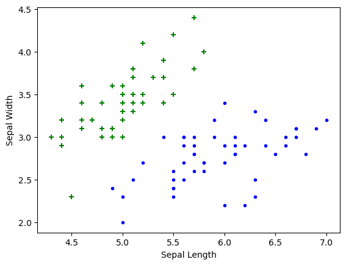
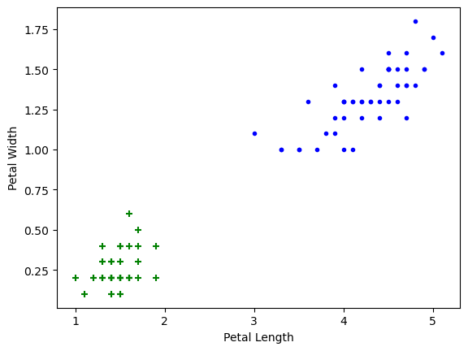

# Support Vector Regression

Support Vector Regression

Author

Benedict Thekkel

``` python
import pandas as pd
from sklearn.datasets import load_iris
iris = load_iris()
```

``` python
iris.feature_names
```

    ['sepal length (cm)',
     'sepal width (cm)',
     'petal length (cm)',
     'petal width (cm)']

``` python
iris.target_names
```

    array(['setosa', 'versicolor', 'virginica'], dtype='<U10')

``` python
df = pd.DataFrame(iris.data,columns=iris.feature_names)
df.head()
```

|     | sepal length (cm) | sepal width (cm) | petal length (cm) | petal width (cm) |
|-----|-------------------|------------------|-------------------|------------------|
| 0   | 5.1               | 3.5              | 1.4               | 0.2              |
| 1   | 4.9               | 3.0              | 1.4               | 0.2              |
| 2   | 4.7               | 3.2              | 1.3               | 0.2              |
| 3   | 4.6               | 3.1              | 1.5               | 0.2              |
| 4   | 5.0               | 3.6              | 1.4               | 0.2              |

``` python
df['target'] = iris.target
df.head()
```

|  | sepal length (cm) | sepal width (cm) | petal length (cm) | petal width (cm) | target |
|----|----|----|----|----|----|
| 0 | 5.1 | 3.5 | 1.4 | 0.2 | 0 |
| 1 | 4.9 | 3.0 | 1.4 | 0.2 | 0 |
| 2 | 4.7 | 3.2 | 1.3 | 0.2 | 0 |
| 3 | 4.6 | 3.1 | 1.5 | 0.2 | 0 |
| 4 | 5.0 | 3.6 | 1.4 | 0.2 | 0 |

``` python
df[df.target==1].head()
```

|  | sepal length (cm) | sepal width (cm) | petal length (cm) | petal width (cm) | target |
|----|----|----|----|----|----|
| 50 | 7.0 | 3.2 | 4.7 | 1.4 | 1 |
| 51 | 6.4 | 3.2 | 4.5 | 1.5 | 1 |
| 52 | 6.9 | 3.1 | 4.9 | 1.5 | 1 |
| 53 | 5.5 | 2.3 | 4.0 | 1.3 | 1 |
| 54 | 6.5 | 2.8 | 4.6 | 1.5 | 1 |

``` python
df[df.target==2].head()
```

|  | sepal length (cm) | sepal width (cm) | petal length (cm) | petal width (cm) | target |
|----|----|----|----|----|----|
| 100 | 6.3 | 3.3 | 6.0 | 2.5 | 2 |
| 101 | 5.8 | 2.7 | 5.1 | 1.9 | 2 |
| 102 | 7.1 | 3.0 | 5.9 | 2.1 | 2 |
| 103 | 6.3 | 2.9 | 5.6 | 1.8 | 2 |
| 104 | 6.5 | 3.0 | 5.8 | 2.2 | 2 |

``` python
df['flower_name'] =df.target.apply(lambda x: iris.target_names[x])
df.head()
```

|  | sepal length (cm) | sepal width (cm) | petal length (cm) | petal width (cm) | target | flower_name |
|----|----|----|----|----|----|----|
| 0 | 5.1 | 3.5 | 1.4 | 0.2 | 0 | setosa |
| 1 | 4.9 | 3.0 | 1.4 | 0.2 | 0 | setosa |
| 2 | 4.7 | 3.2 | 1.3 | 0.2 | 0 | setosa |
| 3 | 4.6 | 3.1 | 1.5 | 0.2 | 0 | setosa |
| 4 | 5.0 | 3.6 | 1.4 | 0.2 | 0 | setosa |

``` python
df[45:55]
```

|  | sepal length (cm) | sepal width (cm) | petal length (cm) | petal width (cm) | target | flower_name |
|----|----|----|----|----|----|----|
| 45 | 4.8 | 3.0 | 1.4 | 0.3 | 0 | setosa |
| 46 | 5.1 | 3.8 | 1.6 | 0.2 | 0 | setosa |
| 47 | 4.6 | 3.2 | 1.4 | 0.2 | 0 | setosa |
| 48 | 5.3 | 3.7 | 1.5 | 0.2 | 0 | setosa |
| 49 | 5.0 | 3.3 | 1.4 | 0.2 | 0 | setosa |
| 50 | 7.0 | 3.2 | 4.7 | 1.4 | 1 | versicolor |
| 51 | 6.4 | 3.2 | 4.5 | 1.5 | 1 | versicolor |
| 52 | 6.9 | 3.1 | 4.9 | 1.5 | 1 | versicolor |
| 53 | 5.5 | 2.3 | 4.0 | 1.3 | 1 | versicolor |
| 54 | 6.5 | 2.8 | 4.6 | 1.5 | 1 | versicolor |

``` python
df0 = df[:50]
df1 = df[50:100]
df2 = df[100:]
```

``` python
import matplotlib.pyplot as plt
```

**Sepal length vs Sepal Width (Setosa vs Versicolor)**

``` python
plt.xlabel('Sepal Length')
plt.ylabel('Sepal Width')
plt.scatter(df0['sepal length (cm)'], df0['sepal width (cm)'],color="green",marker='+')
plt.scatter(df1['sepal length (cm)'], df1['sepal width (cm)'],color="blue",marker='.')
```



**Petal length vs Pepal Width (Setosa vs Versicolor)**

``` python
plt.xlabel('Petal Length')
plt.ylabel('Petal Width')
plt.scatter(df0['petal length (cm)'], df0['petal width (cm)'],color="green",marker='+')
plt.scatter(df1['petal length (cm)'], df1['petal width (cm)'],color="blue",marker='.')
```



**Train Using Support Vector Machine (SVM)**

``` python
from sklearn.model_selection import train_test_split
```

``` python
X = df.drop(['target','flower_name'], axis='columns')
y = df.target
```

``` python
X_train, X_test, y_train, y_test = train_test_split(X, y, test_size=0.2)
```

``` python
len(X_train)
```

    120

``` python
len(X_test)
```

    30

``` python
from sklearn.svm import SVC
model = SVC()
```

``` python
model.fit(X_train, y_train)
```

    SVC()

**In a Jupyter environment, please rerun this cell to show the HTML representation or trust the notebook.\
On GitHub, the HTML representation is unable to render, please try loading this page with nbviewer.org.**

SVC

    SVC()

``` python
model.score(X_test, y_test)
```

    1.0

``` python
model.predict([[4.8,3.0,1.5,0.3]])
```

    /home/benedict/mambaforge/envs/cfast/lib/python3.11/site-packages/sklearn/base.py:464: UserWarning: X does not have valid feature names, but SVC was fitted with feature names
      warnings.warn(

    array([0])

**Tune parameters**

**1. Regularization (C)**

``` python
model_C = SVC(C=1)
model_C.fit(X_train, y_train)
model_C.score(X_test, y_test)
```

    1.0

``` python
model_C = SVC(C=10)
model_C.fit(X_train, y_train)
model_C.score(X_test, y_test)
```

    0.9666666666666667

**2. Gamma**

``` python
model_g = SVC(gamma=10)
model_g.fit(X_train, y_train)
model_g.score(X_test, y_test)
```

    0.9666666666666667

**3. Kernel**

``` python
model_linear_kernal = SVC(kernel='linear')
model_linear_kernal.fit(X_train, y_train)
```

    SVC(kernel='linear')

**In a Jupyter environment, please rerun this cell to show the HTML representation or trust the notebook.\
On GitHub, the HTML representation is unable to render, please try loading this page with nbviewer.org.**

SVC

    SVC(kernel='linear')

``` python
model_linear_kernal.score(X_test, y_test)
```

    0.9666666666666667

**Exercise**

Train SVM classifier using sklearn digits dataset (i.e. from sklearn.datasets import load_digits) and then,

1.  Measure accuracy of your model using different kernels such as rbf and linear.
2.  Tune your model further using regularization and gamma parameters and try to come up with highest accurancy score
3.  Use 80% of samples as training data size

Back to top
