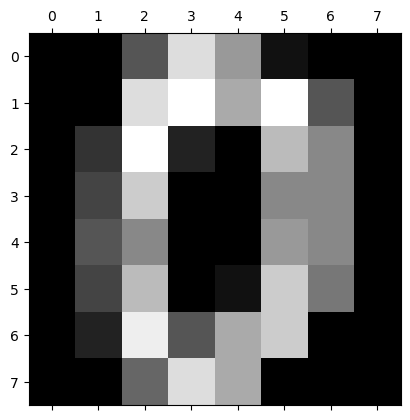
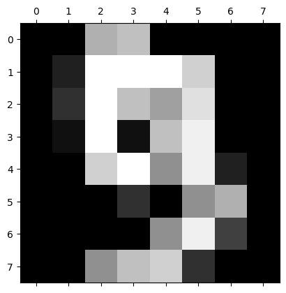

# Principal Component Analysis

For Dimensionality reduction technique

Author

Benedict Thekkel

``` python
from sklearn.datasets import load_digits
import pandas as pd

dataset = load_digits()
dataset.keys()
```

    dict_keys(['data', 'target', 'frame', 'feature_names', 'target_names', 'images', 'DESCR'])

``` python
dataset.data.shape
```

    (1797, 64)

``` python
dataset.data[0]
```

    array([ 0.,  0.,  5., 13.,  9.,  1.,  0.,  0.,  0.,  0., 13., 15., 10.,
           15.,  5.,  0.,  0.,  3., 15.,  2.,  0., 11.,  8.,  0.,  0.,  4.,
           12.,  0.,  0.,  8.,  8.,  0.,  0.,  5.,  8.,  0.,  0.,  9.,  8.,
            0.,  0.,  4., 11.,  0.,  1., 12.,  7.,  0.,  0.,  2., 14.,  5.,
           10., 12.,  0.,  0.,  0.,  0.,  6., 13., 10.,  0.,  0.,  0.])

``` python
dataset.data[0].reshape(8,8)
```

    array([[ 0.,  0.,  5., 13.,  9.,  1.,  0.,  0.],
           [ 0.,  0., 13., 15., 10., 15.,  5.,  0.],
           [ 0.,  3., 15.,  2.,  0., 11.,  8.,  0.],
           [ 0.,  4., 12.,  0.,  0.,  8.,  8.,  0.],
           [ 0.,  5.,  8.,  0.,  0.,  9.,  8.,  0.],
           [ 0.,  4., 11.,  0.,  1., 12.,  7.,  0.],
           [ 0.,  2., 14.,  5., 10., 12.,  0.,  0.],
           [ 0.,  0.,  6., 13., 10.,  0.,  0.,  0.]])

``` python
from matplotlib import pyplot as plt

plt.gray()
plt.matshow(dataset.data[0].reshape(8,8))
```

    <Figure size 640x480 with 0 Axes>



``` python
plt.matshow(dataset.data[9].reshape(8,8))
```



``` python
dataset.target[:5]
```

    array([0, 1, 2, 3, 4])

``` python
df = pd.DataFrame(dataset.data, columns=dataset.feature_names)
df.head()
```

|  | pixel_0_0 | pixel_0_1 | pixel_0_2 | pixel_0_3 | pixel_0_4 | pixel_0_5 | pixel_0_6 | pixel_0_7 | pixel_1_0 | pixel_1_1 | ... | pixel_6_6 | pixel_6_7 | pixel_7_0 | pixel_7_1 | pixel_7_2 | pixel_7_3 | pixel_7_4 | pixel_7_5 | pixel_7_6 | pixel_7_7 |
|----|----|----|----|----|----|----|----|----|----|----|----|----|----|----|----|----|----|----|----|----|----|
| 0 | 0.0 | 0.0 | 5.0 | 13.0 | 9.0 | 1.0 | 0.0 | 0.0 | 0.0 | 0.0 | ... | 0.0 | 0.0 | 0.0 | 0.0 | 6.0 | 13.0 | 10.0 | 0.0 | 0.0 | 0.0 |
| 1 | 0.0 | 0.0 | 0.0 | 12.0 | 13.0 | 5.0 | 0.0 | 0.0 | 0.0 | 0.0 | ... | 0.0 | 0.0 | 0.0 | 0.0 | 0.0 | 11.0 | 16.0 | 10.0 | 0.0 | 0.0 |
| 2 | 0.0 | 0.0 | 0.0 | 4.0 | 15.0 | 12.0 | 0.0 | 0.0 | 0.0 | 0.0 | ... | 5.0 | 0.0 | 0.0 | 0.0 | 0.0 | 3.0 | 11.0 | 16.0 | 9.0 | 0.0 |
| 3 | 0.0 | 0.0 | 7.0 | 15.0 | 13.0 | 1.0 | 0.0 | 0.0 | 0.0 | 8.0 | ... | 9.0 | 0.0 | 0.0 | 0.0 | 7.0 | 13.0 | 13.0 | 9.0 | 0.0 | 0.0 |
| 4 | 0.0 | 0.0 | 0.0 | 1.0 | 11.0 | 0.0 | 0.0 | 0.0 | 0.0 | 0.0 | ... | 0.0 | 0.0 | 0.0 | 0.0 | 0.0 | 2.0 | 16.0 | 4.0 | 0.0 | 0.0 |

5 rows × 64 columns

``` python
dataset.target
```

    array([0, 1, 2, ..., 8, 9, 8])

``` python
df.describe()
```

|  | pixel_0_0 | pixel_0_1 | pixel_0_2 | pixel_0_3 | pixel_0_4 | pixel_0_5 | pixel_0_6 | pixel_0_7 | pixel_1_0 | pixel_1_1 | ... | pixel_6_6 | pixel_6_7 | pixel_7_0 | pixel_7_1 | pixel_7_2 | pixel_7_3 | pixel_7_4 | pixel_7_5 | pixel_7_6 | pixel_7_7 |
|----|----|----|----|----|----|----|----|----|----|----|----|----|----|----|----|----|----|----|----|----|----|
| count | 1797.0 | 1797.000000 | 1797.000000 | 1797.000000 | 1797.000000 | 1797.000000 | 1797.000000 | 1797.000000 | 1797.000000 | 1797.000000 | ... | 1797.000000 | 1797.000000 | 1797.000000 | 1797.000000 | 1797.000000 | 1797.000000 | 1797.000000 | 1797.000000 | 1797.000000 | 1797.000000 |
| mean | 0.0 | 0.303840 | 5.204786 | 11.835838 | 11.848080 | 5.781859 | 1.362270 | 0.129661 | 0.005565 | 1.993879 | ... | 3.725097 | 0.206455 | 0.000556 | 0.279354 | 5.557596 | 12.089037 | 11.809126 | 6.764051 | 2.067891 | 0.364496 |
| std | 0.0 | 0.907192 | 4.754826 | 4.248842 | 4.287388 | 5.666418 | 3.325775 | 1.037383 | 0.094222 | 3.196160 | ... | 4.919406 | 0.984401 | 0.023590 | 0.934302 | 5.103019 | 4.374694 | 4.933947 | 5.900623 | 4.090548 | 1.860122 |
| min | 0.0 | 0.000000 | 0.000000 | 0.000000 | 0.000000 | 0.000000 | 0.000000 | 0.000000 | 0.000000 | 0.000000 | ... | 0.000000 | 0.000000 | 0.000000 | 0.000000 | 0.000000 | 0.000000 | 0.000000 | 0.000000 | 0.000000 | 0.000000 |
| 25% | 0.0 | 0.000000 | 1.000000 | 10.000000 | 10.000000 | 0.000000 | 0.000000 | 0.000000 | 0.000000 | 0.000000 | ... | 0.000000 | 0.000000 | 0.000000 | 0.000000 | 1.000000 | 11.000000 | 10.000000 | 0.000000 | 0.000000 | 0.000000 |
| 50% | 0.0 | 0.000000 | 4.000000 | 13.000000 | 13.000000 | 4.000000 | 0.000000 | 0.000000 | 0.000000 | 0.000000 | ... | 1.000000 | 0.000000 | 0.000000 | 0.000000 | 4.000000 | 13.000000 | 14.000000 | 6.000000 | 0.000000 | 0.000000 |
| 75% | 0.0 | 0.000000 | 9.000000 | 15.000000 | 15.000000 | 11.000000 | 0.000000 | 0.000000 | 0.000000 | 3.000000 | ... | 7.000000 | 0.000000 | 0.000000 | 0.000000 | 10.000000 | 16.000000 | 16.000000 | 12.000000 | 2.000000 | 0.000000 |
| max | 0.0 | 8.000000 | 16.000000 | 16.000000 | 16.000000 | 16.000000 | 16.000000 | 15.000000 | 2.000000 | 16.000000 | ... | 16.000000 | 13.000000 | 1.000000 | 9.000000 | 16.000000 | 16.000000 | 16.000000 | 16.000000 | 16.000000 | 16.000000 |

8 rows × 64 columns

``` python
X = df
y = dataset.target
```

``` python
from sklearn.preprocessing import StandardScaler

scaler = StandardScaler()
X_scaled = scaler.fit_transform(X)
X_scaled
```

    array([[ 0.        , -0.33501649, -0.04308102, ..., -1.14664746,
            -0.5056698 , -0.19600752],
           [ 0.        , -0.33501649, -1.09493684, ...,  0.54856067,
            -0.5056698 , -0.19600752],
           [ 0.        , -0.33501649, -1.09493684, ...,  1.56568555,
             1.6951369 , -0.19600752],
           ...,
           [ 0.        , -0.33501649, -0.88456568, ..., -0.12952258,
            -0.5056698 , -0.19600752],
           [ 0.        , -0.33501649, -0.67419451, ...,  0.8876023 ,
            -0.5056698 , -0.19600752],
           [ 0.        , -0.33501649,  1.00877481, ...,  0.8876023 ,
            -0.26113572, -0.19600752]])

``` python
from sklearn.model_selection import train_test_split

X_train, X_test, y_train, y_test = train_test_split(X_scaled, y, test_size=0.2, random_state=30)
```

``` python
from sklearn.linear_model import LogisticRegression

model = LogisticRegression()
model.fit(X_train, y_train)
model.score(X_test, y_test)
```

    0.9722222222222222

### Use PCA to reduce dimensions

``` python
X
```

|  | pixel_0_0 | pixel_0_1 | pixel_0_2 | pixel_0_3 | pixel_0_4 | pixel_0_5 | pixel_0_6 | pixel_0_7 | pixel_1_0 | pixel_1_1 | ... | pixel_6_6 | pixel_6_7 | pixel_7_0 | pixel_7_1 | pixel_7_2 | pixel_7_3 | pixel_7_4 | pixel_7_5 | pixel_7_6 | pixel_7_7 |
|----|----|----|----|----|----|----|----|----|----|----|----|----|----|----|----|----|----|----|----|----|----|
| 0 | 0.0 | 0.0 | 5.0 | 13.0 | 9.0 | 1.0 | 0.0 | 0.0 | 0.0 | 0.0 | ... | 0.0 | 0.0 | 0.0 | 0.0 | 6.0 | 13.0 | 10.0 | 0.0 | 0.0 | 0.0 |
| 1 | 0.0 | 0.0 | 0.0 | 12.0 | 13.0 | 5.0 | 0.0 | 0.0 | 0.0 | 0.0 | ... | 0.0 | 0.0 | 0.0 | 0.0 | 0.0 | 11.0 | 16.0 | 10.0 | 0.0 | 0.0 |
| 2 | 0.0 | 0.0 | 0.0 | 4.0 | 15.0 | 12.0 | 0.0 | 0.0 | 0.0 | 0.0 | ... | 5.0 | 0.0 | 0.0 | 0.0 | 0.0 | 3.0 | 11.0 | 16.0 | 9.0 | 0.0 |
| 3 | 0.0 | 0.0 | 7.0 | 15.0 | 13.0 | 1.0 | 0.0 | 0.0 | 0.0 | 8.0 | ... | 9.0 | 0.0 | 0.0 | 0.0 | 7.0 | 13.0 | 13.0 | 9.0 | 0.0 | 0.0 |
| 4 | 0.0 | 0.0 | 0.0 | 1.0 | 11.0 | 0.0 | 0.0 | 0.0 | 0.0 | 0.0 | ... | 0.0 | 0.0 | 0.0 | 0.0 | 0.0 | 2.0 | 16.0 | 4.0 | 0.0 | 0.0 |
| ... | ... | ... | ... | ... | ... | ... | ... | ... | ... | ... | ... | ... | ... | ... | ... | ... | ... | ... | ... | ... | ... |
| 1792 | 0.0 | 0.0 | 4.0 | 10.0 | 13.0 | 6.0 | 0.0 | 0.0 | 0.0 | 1.0 | ... | 4.0 | 0.0 | 0.0 | 0.0 | 2.0 | 14.0 | 15.0 | 9.0 | 0.0 | 0.0 |
| 1793 | 0.0 | 0.0 | 6.0 | 16.0 | 13.0 | 11.0 | 1.0 | 0.0 | 0.0 | 0.0 | ... | 1.0 | 0.0 | 0.0 | 0.0 | 6.0 | 16.0 | 14.0 | 6.0 | 0.0 | 0.0 |
| 1794 | 0.0 | 0.0 | 1.0 | 11.0 | 15.0 | 1.0 | 0.0 | 0.0 | 0.0 | 0.0 | ... | 0.0 | 0.0 | 0.0 | 0.0 | 2.0 | 9.0 | 13.0 | 6.0 | 0.0 | 0.0 |
| 1795 | 0.0 | 0.0 | 2.0 | 10.0 | 7.0 | 0.0 | 0.0 | 0.0 | 0.0 | 0.0 | ... | 2.0 | 0.0 | 0.0 | 0.0 | 5.0 | 12.0 | 16.0 | 12.0 | 0.0 | 0.0 |
| 1796 | 0.0 | 0.0 | 10.0 | 14.0 | 8.0 | 1.0 | 0.0 | 0.0 | 0.0 | 2.0 | ... | 8.0 | 0.0 | 0.0 | 1.0 | 8.0 | 12.0 | 14.0 | 12.0 | 1.0 | 0.0 |

1797 rows × 64 columns

#### Use components such that 95% of variance is retained

``` python
from sklearn.decomposition import PCA

pca = PCA(0.95)
X_pca = pca.fit_transform(X)
X_pca.shape
```

    (1797, 29)

``` python
pca.explained_variance_ratio_
```

    array([0.14890594, 0.13618771, 0.11794594, 0.08409979, 0.05782415,
           0.0491691 , 0.04315987, 0.03661373, 0.03353248, 0.03078806,
           0.02372341, 0.02272697, 0.01821863, 0.01773855, 0.01467101,
           0.01409716, 0.01318589, 0.01248138, 0.01017718, 0.00905617,
           0.00889538, 0.00797123, 0.00767493, 0.00722904, 0.00695889,
           0.00596081, 0.00575615, 0.00515158, 0.0048954 ])

``` python
pca.n_components_
```

    29

**PCA created 29 components out of 64 original columns**

``` python
X_pca
```

    array([[ -1.25946645,  21.27488348,  -9.46305462, ...,   3.67072108,
             -0.9436689 ,  -1.13250195],
           [  7.9576113 , -20.76869896,   4.43950604, ...,   2.18261819,
             -0.51022719,   2.31354911],
           [  6.99192297,  -9.95598641,   2.95855808, ...,   4.22882114,
              2.1576573 ,   0.8379578 ],
           ...,
           [ 10.8012837 ,  -6.96025223,   5.59955453, ...,  -3.56866194,
              1.82444444,   3.53885886],
           [ -4.87210009,  12.42395362, -10.17086635, ...,   3.25330054,
              0.95484174,  -0.93895602],
           [ -0.34438963,   6.36554919,  10.77370849, ...,  -3.01636722,
              1.29752723,   2.58810313]])

``` python
X_train_pca, X_test_pca, y_train, y_test = train_test_split(X_pca, y, test_size=0.2, random_state=30)
```

``` python
from sklearn.linear_model import LogisticRegression

model = LogisticRegression(max_iter=1000)
model.fit(X_train_pca, y_train)
model.score(X_test_pca, y_test)
```

    0.9694444444444444

**Let’s now select only two components**

``` python
pca = PCA(n_components=16)
X_pca = pca.fit_transform(X)
X_pca.shape
```

    (1797, 16)

``` python
X_pca
```

    array([[ -1.2594598 ,  21.27487967,  -9.46303989, ...,  -3.31223438,
              6.02583852,   2.68741732],
           [  7.95761297, -20.7686941 ,   4.43950445, ...,  -6.50507014,
             -2.27310577,  -2.14622234],
           [  6.99193119,  -9.95600512,   2.95858793, ...,   6.83484372,
             -1.65925951,  -4.25884236],
           ...,
           [ 10.80128998,  -6.96027365,   5.5995876 , ...,   1.24767177,
              2.62633682,  -5.79460334],
           [ -4.87210168,  12.42396132, -10.17087749, ...,  -1.21624842,
             10.77743555,   2.38010911],
           [ -0.34438951,   6.36554076,  10.77371718, ...,   7.0540168 ,
              0.72142473,   0.27006973]])

``` python
pca.explained_variance_ratio_
```

    array([0.14890594, 0.13618771, 0.11794594, 0.08409979, 0.05782415,
           0.0491691 , 0.04315987, 0.03661373, 0.03353248, 0.03078806,
           0.02372336, 0.02272696, 0.01821856, 0.01773823, 0.01466903,
           0.01409675])

**You can see that both combined retains 0.14+0.13=0.27 or 27% of important feature information**

``` python
X_train_pca, X_test_pca, y_train, y_test = train_test_split(X_pca, y, test_size=0.2, random_state=30)

model = LogisticRegression(max_iter=1000)
model.fit(X_train_pca, y_train)
model.score(X_test_pca, y_test)
```

    0.9472222222222222

We get less accuancy (~60%) as using only 2 components did not retain much of the feature information. However in real life you will find many cases where using 2 or few PCA components can still give you a pretty good accuracy

Back to top
