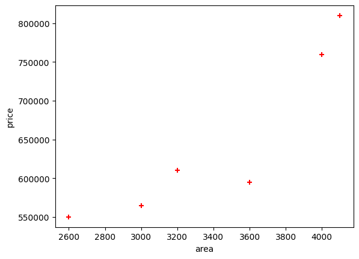
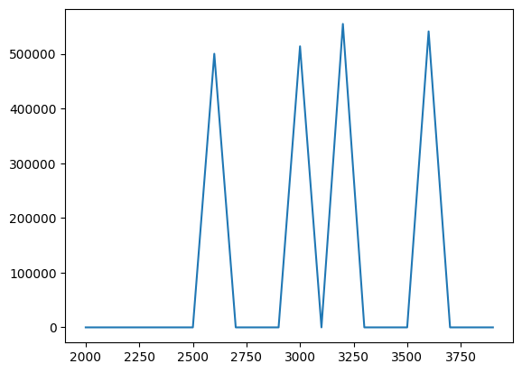

# Kernels Ridge Regression

Kernel Ridge Regression (KRR) is a powerful machine learning technique that combines Ridge Regression with kernel methods. It is particularly useful for non-linear regression tasks where the relationship between the features and the target variable is complex.

Author

Benedict Thekkel

## Basics of Ridge Regression

> Ridge Regression is a type of linear regression that includes a regularization term to prevent overfitting.

------------------------------------------------------------------------

Cost(w)=∑i=1n​(yi​−yi​^​)2+λ∑j=1p​wj2​

where: - yiyi​ is the true value, - yi^(yi​)​ is the predicted value, - wjwj​ are the model coefficients, - λλ is the regularization parameter.

## Kernels

> Kernel methods involve using a kernel function to implicitly map the input features into a higher-dimensional space where a linear relationship might exist. This allows the model to capture non-linear relationships in the original feature space.

------------------------------------------------------------------------

Common kernel functions include:

- Linear Kernel: k(x,x′)=x⋅x′k(x,x′)=x⋅x′
- Polynomial Kernel: k(x,x′)=(x⋅x′+1)dk(x,x′)=(x⋅x′+1)d
- Gaussian (RBF) Kernel: k(x,x′)=exp⁡(−γ∥x−x′∥2)k(x,x′)=exp(−γ∥x−x′∥2)

Advantages of KRR

- Non-linearity: It can model complex, non-linear relationships.
- Flexibility: Different kernels can be used to capture various data patterns.
- Regularization: The regularization term helps prevent overfitting.

Disadvantages of KRR - Computational Cost: Computing the kernel matrix can be computationally expensive, especially for large datasets. - Parameter Tuning: Choosing the right kernel and regularization parameter λλ can be challenging and often requires cross-validation.

## Implementation

``` python
# Example data
X = np.array([[1, 2], [2, 3], [3, 4]])
y = np.array([1, 2, 3])


# Make predictions
predictions = krr.predict(X)
```

``` python
import pandas as pd
import numpy as np
import matplotlib.pyplot as plt
from pathlib import Path
```

``` python
path = Path('Data/homeprices.csv')
df = pd.read_csv(path)
df
```

|     | area | bedrooms | age | price  |
|-----|------|----------|-----|--------|
| 0   | 2600 | 3.0      | 20  | 550000 |
| 1   | 3000 | 4.0      | 15  | 565000 |
| 2   | 3200 | NaN      | 18  | 610000 |
| 3   | 3600 | 3.0      | 30  | 595000 |
| 4   | 4000 | 5.0      | 8   | 760000 |
| 5   | 4100 | 6.0      | 8   | 810000 |

``` python
plt.xlabel('area')
plt.ylabel('price')
plt.scatter(df.area,df.price,color='red',marker='+')

plt.show()
```



``` python
new_df = df.drop('price',axis='columns')
new_df = new_df.drop('bedrooms',axis='columns')
new_df = new_df.drop('age',axis='columns')
new_df
```

|     | area |
|-----|------|
| 0   | 2600 |
| 1   | 3000 |
| 2   | 3200 |
| 3   | 3600 |
| 4   | 4000 |
| 5   | 4100 |

``` python
price = df.price
price
```

    0    550000
    1    565000
    2    610000
    3    595000
    4    760000
    5    810000
    Name: price, dtype: int64

``` python
from sklearn.kernel_ridge import KernelRidge
```

``` python
# Define the model
krr = KernelRidge(alpha=.1, kernel='rbf')

# Fit the model
krr.fit(new_df, price)
```

    KernelRidge(alpha=0.1, kernel='rbf')

**In a Jupyter environment, please rerun this cell to show the HTML representation or trust the notebook.\
On GitHub, the HTML representation is unable to render, please try loading this page with nbviewer.org.**

  KernelRidge[?Documentation for KernelRidge](https://scikit-learn.org/1.5/modules/generated/sklearn.kernel_ridge.KernelRidge.html)iFitted

    KernelRidge(alpha=0.1, kernel='rbf')

``` python
krr.predict([[3300]])
```

    /home/ben/miniconda3/envs/pfast/lib/python3.12/site-packages/sklearn/base.py:493: UserWarning: X does not have valid feature names, but KernelRidge was fitted with feature names
      warnings.warn(

    array([0.])

``` python
krr.predict([[5000]])
```

    /home/ben/miniconda3/envs/pfast/lib/python3.12/site-packages/sklearn/base.py:493: UserWarning: X does not have valid feature names, but KernelRidge was fitted with feature names
      warnings.warn(

    array([0.])

``` python
numbers_list = list(range(2000, 4000, 100))
```

``` python
# Create a DataFrame using the pandas constructor and a dictionary
data = {'area': numbers_list}
area_df = pd.DataFrame(data)
area_df
```

|     | area |
|-----|------|
| 0   | 2000 |
| 1   | 2100 |
| 2   | 2200 |
| 3   | 2300 |
| 4   | 2400 |
| 5   | 2500 |
| 6   | 2600 |
| 7   | 2700 |
| 8   | 2800 |
| 9   | 2900 |
| 10  | 3000 |
| 11  | 3100 |
| 12  | 3200 |
| 13  | 3300 |
| 14  | 3400 |
| 15  | 3500 |
| 16  | 3600 |
| 17  | 3700 |
| 18  | 3800 |
| 19  | 3900 |

``` python
p = krr.predict(area_df)
p
```

    array([     0.        ,      0.        ,      0.        ,      0.        ,
                0.        ,      0.        , 500000.        ,      0.        ,
                0.        ,      0.        , 513636.36363636,      0.        ,
           554545.45454545,      0.        ,      0.        ,      0.        ,
           540909.09090909,      0.        ,      0.        ,      0.        ])

``` python
plt.plot(area_df, p)
```



Back to top
