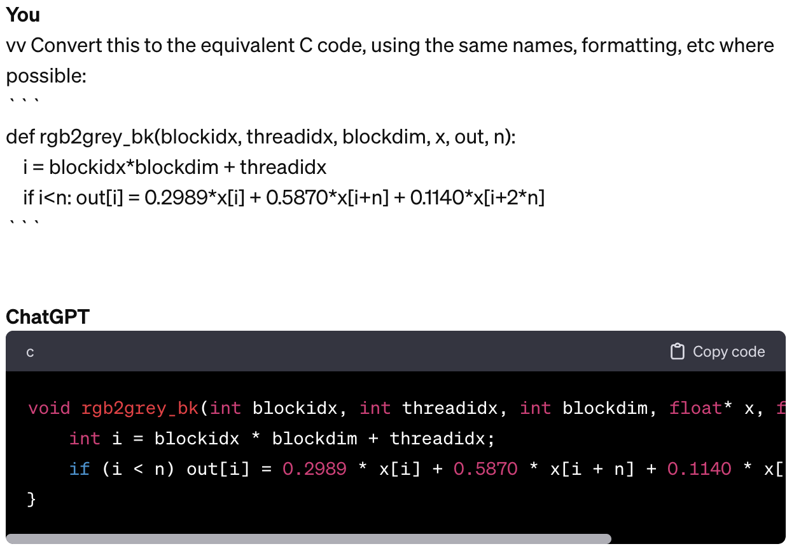
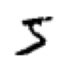

# CUDA

Getting started with CUDA

Author

Benedict Thekkel

## Setup

``` python
import torch, os, math
import torchvision as tv
import torchvision.transforms.functional as tvf
from torchvision import io
import matplotlib.pyplot as plt
from torch.utils.cpp_extension import load_inline
```

``` python
img = io.read_image('puppy.jpg')
print(img.shape)
img[:2,:3,:4]
```

    torch.Size([3, 1330, 1920])

    tensor([[[225, 225, 225, 225],
             [225, 225, 225, 225],
             [225, 225, 225, 225]],

            [[228, 228, 228, 228],
             [228, 228, 228, 228],
             [228, 228, 228, 228]]], dtype=torch.uint8)

``` python
def show_img(x, figsize=(4,3), **kwargs):
    plt.figure(figsize=figsize)
    plt.axis('off')
    if len(x.shape)==3: x = x.permute(1,2,0)  # CHW -> HWC
    plt.imshow(x.cpu(), **kwargs)
```

``` python
img2 = tvf.resize(img, 150, antialias=True)
ch,h,w = img2.shape
ch,h,w,h*w
```

    (3, 150, 216, 32400)

``` python
show_img(img2)
```


## RGB -\> Grey

### Basic Python

``` python
def rgb2grey_py(x):
    c,h,w = x.shape
    n = h*w
    x = x.flatten()
    res = torch.empty(n, dtype=x.dtype, device=x.device)
    for i in range(n): res[i] = 0.2989*x[i] + 0.5870*x[i+n] + 0.1140*x[i+2*n]
    return res.view(h,w)
```

``` python
%%time
img_g = rgb2grey_py(img2)
```

    CPU times: user 1.59 s, sys: 27.1 ms, total: 1.61 s
    Wall time: 1.11 s

``` python
show_img(img_g, cmap='gray')
```


### Python Kernel

``` python
def run_kernel(f, times, *args):
    for i in range(times): f(i, *args)
```

NB: A kernel can not return anything. It can only change contents of things passed to it.

``` python
def rgb2grey_k(i, x, out, n):
    out[i] = 0.2989*x[i] + 0.5870*x[i+n] + 0.1140*x[i+2*n]
```

``` python
def rgb2grey_pyk(x):
    c,h,w = x.shape
    n = h*w
    x = x.flatten()
    res = torch.empty(n, dtype=x.dtype, device=x.device)
    run_kernel(rgb2grey_k, h*w, x, res, n)
    return res.view(h,w)
```

``` python
%%time
img_g = rgb2grey_pyk(img2)
```

    CPU times: user 1.06 s, sys: 0 ns, total: 1.06 s
    Wall time: 1.06 s

``` python
show_img(img_g, cmap='gray')
```


### Python Block Kernel

1.  **Streaming Multiprocessors (SMs):** In NVIDIA GPUs, SMs are the fundamental units of execution. Each SM can execute multiple threads concurrently.
2.  **Thread Blocks:** A thread block is a group of threads that can cooperate among themselves through shared memory and synchronization. All threads in a block are executed on the same SM. This means they can share resources such as shared memory and can synchronize their execution with each other.
3.  **Shared Memory:** Shared memory is a small memory space on the GPU that is shared among the threads in a block. It is much faster than global memory (the main GPU memory), but it is also limited in size. Threads in the same block can use shared memory to share data with each other efficiently.

- The RTX 3090, based on the Ampere architecture, has 82 SMs.
- Each SM in GA10x GPUs contain 128 CUDA Cores, four third-generation Tensor Cores, a 256 KB Register File, and 128 KB of L1/Shared Memory
- In CUDA, all threads in a block have the potential to run concurrently. However, the actual concurrency depends on the number of CUDA cores per SM and the resources required by the threads.

``` python
128*82
```

    10496

``` python
def blk_kernel(f, blocks, threads, *args):
    for i in range(blocks):
        for j in range(threads): f(i, j, threads, *args)
```

``` python
def rgb2grey_bk(blockidx, threadidx, blockdim, x, out, n):
    i = blockidx*blockdim + threadidx
    if i<n: out[i] = 0.2989*x[i] + 0.5870*x[i+n] + 0.1140*x[i+2*n]
```

``` python
def rgb2grey_pybk(x):
    c,h,w = x.shape
    n = h*w
    x = x.flatten()
    res = torch.empty(n, dtype=x.dtype, device=x.device)
    threads = 256
    blocks = int(math.ceil(h*w/threads))
    blk_kernel(rgb2grey_bk, blocks, threads, x, res, n)
    return res.view(h,w)
```

``` python
%%time
img_g = rgb2grey_pybk(img2)
```

    CPU times: user 1.1 s, sys: 0 ns, total: 1.1 s
    Wall time: 1.1 s

``` python
show_img(img_g, cmap='gray')
```


### CUDA Setup

``` python
os.environ['CUDA_LAUNCH_BLOCKING']='1'
```

``` python
os.environ['CUDA_HOME']='/usr/local/cuda'
```

``` python
def load_cuda(cuda_src, cpp_src, funcs, opt=False, verbose=False):
    return load_inline(cuda_sources=[cuda_src], cpp_sources=[cpp_src], functions=funcs,
                       extra_cuda_cflags=["-O2"] if opt else [], verbose=verbose, name="inline_ext")
```

``` python
cuda_begin = r'''
#include <torch/extension.h>
#include <stdio.h>
#include <c10/cuda/CUDAException.h>

#define CHECK_CUDA(x) TORCH_CHECK(x.device().is_cuda(), #x " must be a CUDA tensor")
#define CHECK_CONTIGUOUS(x) TORCH_CHECK(x.is_contiguous(), #x " must be contiguous")
#define CHECK_INPUT(x) CHECK_CUDA(x); CHECK_CONTIGUOUS(x)

inline unsigned int cdiv(unsigned int a, unsigned int b) { return (a + b - 1) / b;}
'''
```

### CUDA kernel

- 2^31 max blocks for dim 0, 2^16 max for dims 1 & 2
- 1024 max threads per block (use a multiple of 32)



``` python
cuda_src = cuda_begin + r'''
__global__ void rgb_to_grayscale_kernel(unsigned char* x, unsigned char* out, int n) {
    int i = blockIdx.x*blockDim.x + threadIdx.x;
    if (i<n) out[i] = 0.2989*x[i] + 0.5870*x[i+n] + 0.1140*x[i+2*n];
}

torch::Tensor rgb_to_grayscale(torch::Tensor input) {
    CHECK_INPUT(input);
    int h = input.size(1);
    int w = input.size(2);
    printf("h*w: %d*%d\n", h, w);
    auto output = torch::empty({h,w}, input.options());
    int threads = 256;
    rgb_to_grayscale_kernel<<<cdiv(w*h,threads), threads>>>(
        input.data_ptr<unsigned char>(), output.data_ptr<unsigned char>(), w*h);
    C10_CUDA_KERNEL_LAUNCH_CHECK();
    return output;
}'''
```

``` python
cpp_src = "torch::Tensor rgb_to_grayscale(torch::Tensor input);"
```

``` python
module = load_cuda(cuda_src, cpp_src, ['rgb_to_grayscale'], verbose=True)
```

    Using /home/ben/.cache/torch_extensions/py311_cu118 as PyTorch extensions root...
    No modifications detected for re-loaded extension module inline_ext, skipping build step...
    Loading extension module inline_ext...

    ---------------------------------------------------------------------------
    ImportError                               Traceback (most recent call last)
    Cell In[33], line 1
    ----> 1 module = load_cuda(cuda_src, cpp_src, ['rgb_to_grayscale'], verbose=True)

    Cell In[29], line 2, in load_cuda(cuda_src, cpp_src, funcs, opt, verbose)
          1 def load_cuda(cuda_src, cpp_src, funcs, opt=False, verbose=False):
    ----> 2     return load_inline(cuda_sources=[cuda_src], cpp_sources=[cpp_src], functions=funcs,
          3                        extra_cuda_cflags=["-O2"] if opt else [], verbose=verbose, name="inline_ext")

    File ~/mambaforge/envs/cfast/lib/python3.11/site-packages/torch/utils/cpp_extension.py:1434, in load_inline(name, cpp_sources, cuda_sources, functions, extra_cflags, extra_cuda_cflags, extra_ldflags, extra_include_paths, build_directory, verbose, with_cuda, is_python_module, with_pytorch_error_handling, keep_intermediates)
       1430         cuda_source_file.write('\n'.join(cuda_sources))
       1432     sources.append(cuda_source_path)
    -> 1434 return _jit_compile(
       1435     name,
       1436     sources,
       1437     extra_cflags,
       1438     extra_cuda_cflags,
       1439     extra_ldflags,
       1440     extra_include_paths,
       1441     build_directory,
       1442     verbose,
       1443     with_cuda,
       1444     is_python_module,
       1445     is_standalone=False,
       1446     keep_intermediates=keep_intermediates)

    File ~/mambaforge/envs/cfast/lib/python3.11/site-packages/torch/utils/cpp_extension.py:1535, in _jit_compile(name, sources, extra_cflags, extra_cuda_cflags, extra_ldflags, extra_include_paths, build_directory, verbose, with_cuda, is_python_module, is_standalone, keep_intermediates)
       1532 if is_standalone:
       1533     return _get_exec_path(name, build_directory)
    -> 1535 return _import_module_from_library(name, build_directory, is_python_module)

    File ~/mambaforge/envs/cfast/lib/python3.11/site-packages/torch/utils/cpp_extension.py:1929, in _import_module_from_library(module_name, path, is_python_module)
       1927 spec = importlib.util.spec_from_file_location(module_name, filepath)
       1928 assert spec is not None
    -> 1929 module = importlib.util.module_from_spec(spec)
       1930 assert isinstance(spec.loader, importlib.abc.Loader)
       1931 spec.loader.exec_module(module)

    File <frozen importlib._bootstrap>:573, in module_from_spec(spec)

    File <frozen importlib._bootstrap_external>:1233, in create_module(self, spec)

    File <frozen importlib._bootstrap>:241, in _call_with_frames_removed(f, *args, **kwds)

    ImportError: /home/ben/.cache/torch_extensions/py311_cu118/inline_ext/inline_ext.so: cannot open shared object file: No such file or directory

``` python
[o for o in dir(module) if o[0]!='_']
```

``` python
imgc = img.contiguous().cuda()
```

``` python
%%time
res = module.rgb_to_grayscale(imgc).cpu()
h,w = res.shape
h,w,h*w
```

``` python
show_img(res, cmap='gray')
```

## Matmul

### Get data

``` python
import gzip,pickle
from urllib.request import urlretrieve
from pathlib import Path
from torch import tensor
```

``` python
MNIST_URL='https://github.com/mnielsen/neural-networks-and-deep-learning/blob/master/data/mnist.pkl.gz?raw=true'
path_data = Path('data')
path_data.mkdir(exist_ok=True)
path_gz = path_data/'mnist.pkl.gz'
if not path_gz.exists(): urlretrieve(MNIST_URL, path_gz)
```

``` python
with gzip.open(path_gz, 'rb') as f: ((x_train, y_train), (x_valid, y_valid), _) = pickle.load(f, encoding='latin-1')
x_train,y_train,x_valid,y_valid = map(tensor, (x_train,y_train,x_valid,y_valid))
x_train.shape,x_train.type()
```

    (torch.Size([50000, 784]), 'torch.FloatTensor')

``` python
imgs = x_train.reshape((-1,28,28))
imgs.shape
```

    torch.Size([50000, 28, 28])

``` python
show_img(imgs[0], cmap='gray_r', figsize=(1,1))
```



``` python
torch.manual_seed(1)
weights = torch.randn(784,10)
weights
```

    tensor([[-1.5256, -0.7502, -0.6540,  ..., -1.6091, -0.7121,  0.3037],
            [-0.7773, -0.2515, -0.2223,  ..., -1.1608,  0.6995,  0.1991],
            [ 0.8657,  0.2444, -0.6629,  ..., -1.4465,  0.0612, -0.6177],
            ...,
            [ 0.5063,  0.4656, -0.2634,  ...,  0.6452,  0.4298, -1.2936],
            [ 0.5171,  1.0315,  0.8120,  ..., -0.1046,  2.2588, -0.2793],
            [-1.4899,  0.3898, -0.5454,  ..., -0.1923, -0.5076,  0.5439]])

### Python matmul

``` python
m1 = x_valid[:5]
m2 = weights
m1.shape,m2.shape
```

    (torch.Size([5, 784]), torch.Size([784, 10]))

``` python
ar,ac = m1.shape # n_rows * n_cols
br,bc = m2.shape
(ar,ac),(br,bc)
```

    ((5, 784), (784, 10))

``` python
t1 = torch.zeros(ar, bc)
t1.shape
```

    torch.Size([5, 10])

``` python
for i in range(ar):         # 5
    for j in range(bc):     # 10
        for k in range(ac): # 784
            t1[i,j] += m1[i,k] * m2[k,j]
```

``` python
t1.shape
```

    torch.Size([5, 10])

``` python
import numpy as np
np.set_printoptions(precision=2, linewidth=140)
torch.set_printoptions(precision=2, linewidth=140, sci_mode=False)
```

``` python
t1
```

    tensor([[-10.94,  -0.68,  -7.00,  -4.01,  -2.09,  -3.36,   3.91,  -3.44, -11.47,  -2.12],
            [ 14.54,   6.00,   2.89,  -4.08,   6.59, -14.74,  -9.28,   2.16, -15.28,  -2.68],
            [  2.22,  -3.22,  -4.80,  -6.05,  14.17,  -8.98,  -4.79,  -5.44, -20.68,  13.57],
            [ -6.71,   8.90,  -7.46,  -7.90,   2.70,  -4.73, -11.03, -12.98,  -6.44,   3.64],
            [ -2.44,  -6.40,  -2.40,  -9.04,  11.18,  -5.77,  -8.92,  -3.79,  -8.98,   5.28]])

``` python
def matmul(a,b):
    (ar,ac),(br,bc) = a.shape,b.shape
    c = torch.zeros(ar, bc)
    for i in range(ar):
        for j in range(bc):
            for k in range(ac): c[i,j] += a[i,k] * b[k,j]
    return c
```

``` python
%time _=matmul(m1, m2)
```

    CPU times: user 603 ms, sys: 0 ns, total: 603 ms
    Wall time: 603 ms

``` python
ar*bc*ac
```

    39200

### 2d Python kernel

``` python
from types import SimpleNamespace as ns
```

``` python
def blk_kernel2d(f, blocks, threads, *args):
    for i0 in range(blocks.y):
        for i1 in range(blocks.x):
            for j0 in range(threads.y):
                for j1 in range(threads.x): f(ns(x=i1,y=i0), ns(x=j1,y=j0), threads, *args)
```

``` python
def matmul_bk(blockidx, threadidx, blockdim, m, n, out, h, w, k):
    r = blockidx.y*blockdim.y + threadidx.y
    c = blockidx.x*blockdim.x + threadidx.x
    
    if (r>=h or c>=w): return
    o = 0.
    for i in range(k): o += m[r*k+i] * n[i*w+c]
    out[r*w+c] = o
```

``` python
def matmul_2d(m, n):
    h,k  = m.shape
    k2,w = n.shape
    assert k==k2, "Size mismatch!"
    output = torch.zeros(h, w, dtype=m.dtype)
    tpb = ns(x=16,y=16)
    blocks = ns(x=math.ceil(w/tpb.x), y=math.ceil(h/tpb.y))
    blk_kernel2d(matmul_bk, blocks, tpb,
                 m.flatten(), n.flatten(), output.flatten(), h, w, k)
    return output
```

``` python
res = matmul_2d(m1, m2)
torch.isclose(t1, res).all()
```

    tensor(True)

### Broadcasting

``` python
def matmul(a,b):
    (ar,ac),(br,bc) = a.shape,b.shape
    c = torch.zeros(ar, bc)
    for i in range(ar): c[i] = (a[i,:,None] * b).sum(dim=0)
    return c
```

``` python
torch.isclose(t1,matmul(m1, m2)).all()
```

    tensor(True)

``` python
%time _=matmul(m1, m2)
```

    CPU times: user 1.84 ms, sys: 286 µs, total: 2.13 ms
    Wall time: 1.79 ms

``` python
m1 = x_train
tr = matmul(m1, m2)
tr.shape
```

    torch.Size([50000, 10])

``` python
%time _=matmul(m1, m2)
```

    CPU times: user 2.33 s, sys: 11.2 ms, total: 2.34 s
    Wall time: 1.32 s

``` python
ar,ac = m1.shape
br,bc = m2.shape
ar*bc*ac
```

    392000000

### CUDA matmul

``` python
cuda_src = cuda_begin + r'''
__global__ void matmul_k(float* m, float* n, float* out, int h, int w, int k) {
    int r = blockIdx.y*blockDim.y + threadIdx.y;
    int c = blockIdx.x*blockDim.x + threadIdx.x;

    if (r>=h || c>=w) return;
    float o = 0;
    for (int i = 0; i<k; ++i) o += m[r*k+i] * n[i*w+c];
    out[r*w+c] = o;
}

torch::Tensor matmul(torch::Tensor m, torch::Tensor n) {
    CHECK_INPUT(m); CHECK_INPUT(n);
    int h = m.size(0);
    int w = n.size(1);
    int k = m.size(1);
    TORCH_CHECK(k==n.size(0), "Size mismatch!");
    auto output = torch::zeros({h, w}, m.options());

    dim3 tpb(16,16);
    dim3 blocks(cdiv(w, tpb.x), cdiv(h, tpb.y));
    matmul_k<<<blocks, tpb>>>(
        m.data_ptr<float>(), n.data_ptr<float>(), output.data_ptr<float>(), h, w, k);
    C10_CUDA_KERNEL_LAUNCH_CHECK();
    return output;
}
'''
```

``` python
cpp_src = "torch::Tensor matmul(torch::Tensor m, torch::Tensor n);"
```

``` python
module = load_cuda(cuda_src, cpp_src, ['matmul'])
```

    ---------------------------------------------------------------------------
    OSError                                   Traceback (most recent call last)
    Cell In[63], line 1
    ----> 1 module = load_cuda(cuda_src, cpp_src, ['matmul'])

    Cell In[29], line 2, in load_cuda(cuda_src, cpp_src, funcs, opt, verbose)
          1 def load_cuda(cuda_src, cpp_src, funcs, opt=False, verbose=False):
    ----> 2     return load_inline(cuda_sources=[cuda_src], cpp_sources=[cpp_src], functions=funcs,
          3                        extra_cuda_cflags=["-O2"] if opt else [], verbose=verbose, name="inline_ext")

    File ~/mambaforge/envs/cfast/lib/python3.11/site-packages/torch/utils/cpp_extension.py:1434, in load_inline(name, cpp_sources, cuda_sources, functions, extra_cflags, extra_cuda_cflags, extra_ldflags, extra_include_paths, build_directory, verbose, with_cuda, is_python_module, with_pytorch_error_handling, keep_intermediates)
       1430         cuda_source_file.write('\n'.join(cuda_sources))
       1432     sources.append(cuda_source_path)
    -> 1434 return _jit_compile(
       1435     name,
       1436     sources,
       1437     extra_cflags,
       1438     extra_cuda_cflags,
       1439     extra_ldflags,
       1440     extra_include_paths,
       1441     build_directory,
       1442     verbose,
       1443     with_cuda,
       1444     is_python_module,
       1445     is_standalone=False,
       1446     keep_intermediates=keep_intermediates)

    File ~/mambaforge/envs/cfast/lib/python3.11/site-packages/torch/utils/cpp_extension.py:1509, in _jit_compile(name, sources, extra_cflags, extra_cuda_cflags, extra_ldflags, extra_include_paths, build_directory, verbose, with_cuda, is_python_module, is_standalone, keep_intermediates)
       1505                 hipified_sources.add(hipify_result[s_abs]["hipified_path"] if s_abs in hipify_result else s_abs)
       1507             sources = list(hipified_sources)
    -> 1509         _write_ninja_file_and_build_library(
       1510             name=name,
       1511             sources=sources,
       1512             extra_cflags=extra_cflags or [],
       1513             extra_cuda_cflags=extra_cuda_cflags or [],
       1514             extra_ldflags=extra_ldflags or [],
       1515             extra_include_paths=extra_include_paths or [],
       1516             build_directory=build_directory,
       1517             verbose=verbose,
       1518             with_cuda=with_cuda,
       1519             is_standalone=is_standalone)
       1520 finally:
       1521     baton.release()

    File ~/mambaforge/envs/cfast/lib/python3.11/site-packages/torch/utils/cpp_extension.py:1601, in _write_ninja_file_and_build_library(name, sources, extra_cflags, extra_cuda_cflags, extra_ldflags, extra_include_paths, build_directory, verbose, with_cuda, is_standalone)
       1599 if with_cuda is None:
       1600     with_cuda = any(map(_is_cuda_file, sources))
    -> 1601 extra_ldflags = _prepare_ldflags(
       1602     extra_ldflags or [],
       1603     with_cuda,
       1604     verbose,
       1605     is_standalone)
       1606 build_file_path = os.path.join(build_directory, 'build.ninja')
       1607 if verbose:

    File ~/mambaforge/envs/cfast/lib/python3.11/site-packages/torch/utils/cpp_extension.py:1699, in _prepare_ldflags(extra_ldflags, with_cuda, verbose, is_standalone)
       1697         extra_ldflags.append(f'/LIBPATH:{os.path.join(CUDNN_HOME, "lib", "x64")}')
       1698 elif not IS_HIP_EXTENSION:
    -> 1699     extra_ldflags.append(f'-L{_join_cuda_home("lib64")}')
       1700     extra_ldflags.append('-lcudart')
       1701     if CUDNN_HOME is not None:

    File ~/mambaforge/envs/cfast/lib/python3.11/site-packages/torch/utils/cpp_extension.py:2223, in _join_cuda_home(*paths)
       2216 r'''
       2217 Joins paths with CUDA_HOME, or raises an error if it CUDA_HOME is not set.
       2218 
       2219 This is basically a lazy way of raising an error for missing $CUDA_HOME
       2220 only once we need to get any CUDA-specific path.
       2221 '''
       2222 if CUDA_HOME is None:
    -> 2223     raise EnvironmentError('CUDA_HOME environment variable is not set. '
       2224                            'Please set it to your CUDA install root.')
       2225 return os.path.join(CUDA_HOME, *paths)

    OSError: CUDA_HOME environment variable is not set. Please set it to your CUDA install root.

``` python
m1c,m2c = m1.contiguous().cuda(), m2.contiguous().cuda()
```

``` python
torch.isclose(tr,module.matmul(m1c, m2c).cpu(), atol=1e-5).all()
```

    ---------------------------------------------------------------------------
    NameError                                 Traceback (most recent call last)
    Cell In[66], line 1
    ----> 1 torch.isclose(tr,module.matmul(m1c, m2c).cpu(), atol=1e-5).all()

    NameError: name 'module' is not defined

``` python
%%time
res=module.matmul(m1c, m2c).cpu()
res.shape
```

    ---------------------------------------------------------------------------
    NameError                                 Traceback (most recent call last)
    File <timed exec>:1

    NameError: name 'module' is not defined

### Pytorch

``` python
torch.isclose(tr,(m1c@m2c).cpu(), atol=1e-5).all()
```

    tensor(True)

``` python
%timeit -n 10 _=(m1c@m2c).cpu()
```

    The slowest run took 11.09 times longer than the fastest. This could mean that an intermediate result is being cached.
    5.98 ms ± 7.14 ms per loop (mean ± std. dev. of 7 runs, 10 loops each)

### RGB-\>Grey CUDA 3d

``` python
cuda_src = cuda_begin + r'''
__global__ void rgb_to_grayscale_kernel(unsigned char* x, unsigned char* out, int w, int h) {
    int c = blockIdx.x*blockDim.x + threadIdx.x;
    int r = blockIdx.y*blockDim.y + threadIdx.y;

    if (c<w && r<h) {
        int i = r*w + c;
        int n = h*w;
        out[i] = 0.2989*x[i] + 0.5870*x[i+n] + 0.1140*x[i+2*n];
    }
}

torch::Tensor rgb_to_grayscale(torch::Tensor input) {
    CHECK_INPUT(input);
    int h = input.size(1);
    int w = input.size(2);
    torch::Tensor output = torch::empty({h,w}, input.options());
    dim3 tpb(16,16);
    dim3 blocks(cdiv(w, tpb.x), cdiv(h, tpb.y));
    rgb_to_grayscale_kernel<<<blocks, tpb>>>(
        input.data_ptr<unsigned char>(), output.data_ptr<unsigned char>(), w, h);
    C10_CUDA_KERNEL_LAUNCH_CHECK();
    return output;
}'''
```

``` python
module = load_cuda(cuda_src, cpp_src, ['rgb_to_grayscale'])
```

    ---------------------------------------------------------------------------
    OSError                                   Traceback (most recent call last)
    Cell In[71], line 1
    ----> 1 module = load_cuda(cuda_src, cpp_src, ['rgb_to_grayscale'])

    Cell In[29], line 2, in load_cuda(cuda_src, cpp_src, funcs, opt, verbose)
          1 def load_cuda(cuda_src, cpp_src, funcs, opt=False, verbose=False):
    ----> 2     return load_inline(cuda_sources=[cuda_src], cpp_sources=[cpp_src], functions=funcs,
          3                        extra_cuda_cflags=["-O2"] if opt else [], verbose=verbose, name="inline_ext")

    File ~/mambaforge/envs/cfast/lib/python3.11/site-packages/torch/utils/cpp_extension.py:1434, in load_inline(name, cpp_sources, cuda_sources, functions, extra_cflags, extra_cuda_cflags, extra_ldflags, extra_include_paths, build_directory, verbose, with_cuda, is_python_module, with_pytorch_error_handling, keep_intermediates)
       1430         cuda_source_file.write('\n'.join(cuda_sources))
       1432     sources.append(cuda_source_path)
    -> 1434 return _jit_compile(
       1435     name,
       1436     sources,
       1437     extra_cflags,
       1438     extra_cuda_cflags,
       1439     extra_ldflags,
       1440     extra_include_paths,
       1441     build_directory,
       1442     verbose,
       1443     with_cuda,
       1444     is_python_module,
       1445     is_standalone=False,
       1446     keep_intermediates=keep_intermediates)

    File ~/mambaforge/envs/cfast/lib/python3.11/site-packages/torch/utils/cpp_extension.py:1509, in _jit_compile(name, sources, extra_cflags, extra_cuda_cflags, extra_ldflags, extra_include_paths, build_directory, verbose, with_cuda, is_python_module, is_standalone, keep_intermediates)
       1505                 hipified_sources.add(hipify_result[s_abs]["hipified_path"] if s_abs in hipify_result else s_abs)
       1507             sources = list(hipified_sources)
    -> 1509         _write_ninja_file_and_build_library(
       1510             name=name,
       1511             sources=sources,
       1512             extra_cflags=extra_cflags or [],
       1513             extra_cuda_cflags=extra_cuda_cflags or [],
       1514             extra_ldflags=extra_ldflags or [],
       1515             extra_include_paths=extra_include_paths or [],
       1516             build_directory=build_directory,
       1517             verbose=verbose,
       1518             with_cuda=with_cuda,
       1519             is_standalone=is_standalone)
       1520 finally:
       1521     baton.release()

    File ~/mambaforge/envs/cfast/lib/python3.11/site-packages/torch/utils/cpp_extension.py:1601, in _write_ninja_file_and_build_library(name, sources, extra_cflags, extra_cuda_cflags, extra_ldflags, extra_include_paths, build_directory, verbose, with_cuda, is_standalone)
       1599 if with_cuda is None:
       1600     with_cuda = any(map(_is_cuda_file, sources))
    -> 1601 extra_ldflags = _prepare_ldflags(
       1602     extra_ldflags or [],
       1603     with_cuda,
       1604     verbose,
       1605     is_standalone)
       1606 build_file_path = os.path.join(build_directory, 'build.ninja')
       1607 if verbose:

    File ~/mambaforge/envs/cfast/lib/python3.11/site-packages/torch/utils/cpp_extension.py:1699, in _prepare_ldflags(extra_ldflags, with_cuda, verbose, is_standalone)
       1697         extra_ldflags.append(f'/LIBPATH:{os.path.join(CUDNN_HOME, "lib", "x64")}')
       1698 elif not IS_HIP_EXTENSION:
    -> 1699     extra_ldflags.append(f'-L{_join_cuda_home("lib64")}')
       1700     extra_ldflags.append('-lcudart')
       1701     if CUDNN_HOME is not None:

    File ~/mambaforge/envs/cfast/lib/python3.11/site-packages/torch/utils/cpp_extension.py:2223, in _join_cuda_home(*paths)
       2216 r'''
       2217 Joins paths with CUDA_HOME, or raises an error if it CUDA_HOME is not set.
       2218 
       2219 This is basically a lazy way of raising an error for missing $CUDA_HOME
       2220 only once we need to get any CUDA-specific path.
       2221 '''
       2222 if CUDA_HOME is None:
    -> 2223     raise EnvironmentError('CUDA_HOME environment variable is not set. '
       2224                            'Please set it to your CUDA install root.')
       2225 return os.path.join(CUDA_HOME, *paths)

    OSError: CUDA_HOME environment variable is not set. Please set it to your CUDA install root.

``` python
res = module.rgb_to_grayscale(imgc).cpu()
show_img(res, cmap='gray')
```

    ---------------------------------------------------------------------------
    NameError                                 Traceback (most recent call last)
    Cell In[72], line 1
    ----> 1 res = module.rgb_to_grayscale(imgc).cpu()
          2 show_img(res, cmap='gray')

    NameError: name 'module' is not defined

Back to top
