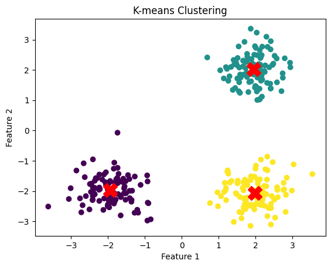

# K Mean Clustering

K-means clustering is one of the most widely used unsupervised machine learning algorithms for clustering data into distinct groups.

Author

Benedict Thekkel

## Introduction to K-means Clustering

> K-means clustering aims to partition a dataset into KK distinct, non-overlapping clusters. Each cluster is represented by its centroid, and the goal is to minimize the sum of the squared distances between each point and its corresponding centroid.

------------------------------------------------------------------------

### 1.1. Objective Function

The objective of K-means is to minimize the inertia, also known as the within-cluster sum of squares (WCSS):

Inertia=∑k=1K∑x∈Ck∥x−μk∥2Inertia=∑k=1K​∑x∈Ck​​∥x−μk​∥2

where: - KK is the number of clusters. - CkCk​ is the set of points in cluster kk. - μkμk​ is the centroid of cluster kk. - ∥x−μk∥∥x−μk​∥ is the Euclidean distance between point xx and centroid μkμk​.

## Algorithm Steps

K-means clustering involves the following iterative process: - Initialization: Randomly select KK initial centroids. - Assignment Step: Assign each data point to the nearest centroid, forming KK clusters. - Update Step: Recalculate the centroids of each cluster based on the current assignments. - Convergence Check: Repeat the assignment and update steps until the centroids no longer change significantly or a maximum number of iterations is reached.

------------------------------------------------------------------------

## Choosing the Number of Clusters (K)

Determining the appropriate number of clusters is a critical decision. Some common methods include: - Elbow Method: Plot the inertia for different values of KK. The “elbow” point, where the rate of decrease sharply slows down, indicates a suitable number of clusters. - Silhouette Score: Measures the quality of the clustering by evaluating how similar a point is to its own cluster compared to other clusters. A higher silhouette score indicates better-defined clusters.

------------------------------------------------------------------------

## Advantages and Disadvantages

Advantages: - Simplicity: Easy to understand and implement. - Scalability: Efficient for large datasets, especially when using the Lloyd’s algorithm.

Disadvantages: - Fixed Number of Clusters: The number of clusters KK must be specified in advance. - Sensitivity to Initialization: The final clusters can vary based on the initial selection of centroids. - Not Suitable for Non-Globular Clusters: K-means assumes that clusters are spherical and of similar size, which may not always be the case. - Sensitive to Outliers: Outliers can distort the cluster centroids significantly.

------------------------------------------------------------------------

## Example with Python

``` python
import numpy as np
import matplotlib.pyplot as plt
from sklearn.cluster import KMeans

# Generating synthetic data
np.random.seed(42)
X = np.vstack([
    np.random.normal(loc=[2, 2], scale=0.5, size=(100, 2)),
    np.random.normal(loc=[-2, -2], scale=0.5, size=(100, 2)),
    np.random.normal(loc=[2, -2], scale=0.5, size=(100, 2))
])

# Applying K-means clustering
kmeans = KMeans(n_clusters=3, random_state=42)
kmeans.fit(X)

# Plotting the results
plt.scatter(X[:, 0], X[:, 1], c=kmeans.labels_, cmap='viridis')
plt.scatter(kmeans.cluster_centers_[:, 0], kmeans.cluster_centers_[:, 1], s=300, c='red', marker='X')
plt.title('K-means Clustering')
plt.xlabel('Feature 1')
plt.ylabel('Feature 2')
plt.show()
```



Practical Considerations

- Data Preprocessing: Standardizing the data can improve the performance of K-means, especially when features have different units or scales.
- Algorithm Variants: Variants like MiniBatchKMeans can be used for large datasets as they are more memory-efficient.
- Evaluation: Use metrics like the inertia, silhouette score, or cluster purity to evaluate the quality of the clusters.

## Extensions and Alternatives

- K-means++: A variant that improves the initialization of centroids, leading to better results.
- Hierarchical Clustering: Does not require the number of clusters to be specified in advance.
- DBSCAN: Can find clusters of arbitrary shape and is robust to outliers.
- Gaussian Mixture Models (GMM): A probabilistic model that can represent clusters with elliptical shapes.

Back to top
